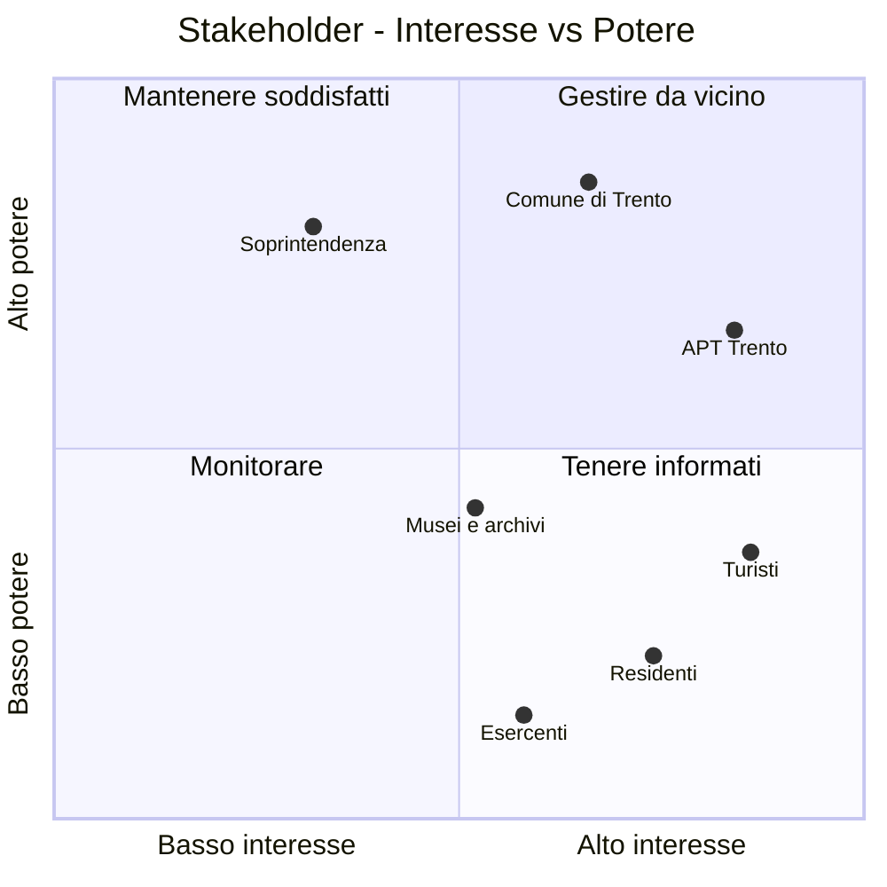

# Fase 1 — Analisi del Dominio, Personas e Stakeholder

**Progetto:** Discover Tridentum — Trento Nascosta
**Corso:** Ingegneria del Software · Prof. Paolo Giorgini · A.A. 2026-2027
**Team:** Manuel Bulla · Marco Buffa · Pietro Crea
**Versione:** 0.1 (bozza)

---

## Indice

1. [Analisi del dominio](#1-analisi-del-dominio)
2. [Personas](#2-personas)
3. [Stakeholder Matrix (Interesse vs Potere)](#3-stakeholder-matrix-interesse-vs-potere)
4. [Matrice di tracciabilità dei bisogni](#4-matrice-di-tracciabilità-dei-bisogni)
5. [Punti aperti](#5-punti-aperti)

---

## 1. Analisi del dominio

### 1.1 Contesto

Il Trentino-Alto Adige è la seconda regione più visitata d'Italia. Trento accoglie circa **1,4 milioni di turisti l'anno**, con una permanenza media di **2,7 giorni**, in crescita rispetto agli anni precedenti.

L'offerta di informazioni turistiche si concentra sulla storia "ufficiale" (il Concilio di Trento, il passato asburgico, il Castello del Buonconsiglio). Resta invece poco raccontata la storia più **popolare e cittadina**:

- la *Tridentum* romana;
- i bombardamenti della Seconda guerra mondiale e la ricostruzione;
- lo spostamento del corso dell'Adige e dei suoi argini;
- le storie delle famiglie e dei quartieri.

Il centro storico conserva inoltre molti **affreschi** (facciate dipinte, decorazioni di palazzi) difficili da identificare e da cercare online.

### 1.2 Problemi individuati

| ID | Problema | Chi lo vive |
|---|---|---|
| **P1** | I flussi turistici si concentrano su pochi luoghi e su una storia sola | Turisti, Comune |
| **P2** | La storia popolare e cittadina è trascurata e frammentata | Residenti, Turisti |
| **P3** | Gli affreschi del centro sono difficili da identificare e da cercare online | Turisti, Residenti |
| **P4** | Le informazioni sono scarse, sparse su più fonti o a pagamento (guide, tour) | Turisti |
| **P5** | I residenti non hanno un canale per condividere foto e ricordi della città | Residenti |
| **P6** | Con 2,7 giorni di permanenza media, il turista non sa come organizzare il tempo e cosa fare dopo i luoghi principali | Turisti, APT |

### 1.3 Glossario

| Termine | Definizione |
|---|---|
| **POI** (Point of Interest) | Luogo geolocalizzato con una scheda: monumento, affresco, piazza, locale tipico |
| **Scheda** | Pagina di un POI con descrizione storica, immagini, fonti e contenuti della community |
| **Contenuto UGC** | Contenuto generato dagli utenti (foto, aneddoto, "fun fact") collegato a un POI |
| **Moderatore** | Utente con il compito di approvare o rifiutare i contenuti UGC prima della pubblicazione |
| **Itinerario** | Sequenza ordinata di POI, tematica o costruita in base al tempo disponibile |
| **"Dov'era?"** | Minigame: l'utente vede una foto storica e indica sulla mappa dove è stata scattata |

### 1.4 Attori del sistema

- **Visitatore anonimo**: consulta mappa, schede e itinerari senza registrarsi.
- **Utente registrato**: in più carica foto e aneddoti, gioca a "Dov'era?", salva itinerari.
- **Moderatore**: verifica i contenuti UGC e le fonti.
- **Amministratore**: gestisce POI, itinerari, utenti e ruoli.

---

## 2. Personas

> Le personas sono profili fittizi costruiti a partire dai dati di contesto e dai problemi individuati. Rappresentano i due gruppi di utenti principali.

### 2.1 Persona A — Il turista: *Giulia*

| | |
|---|---|
| **Età** | 31 anni |
| **Provenienza** | Bologna |
| **Occupazione** | Grafica in un'agenzia di comunicazione |
| **Viaggio** | Weekend lungo a Trento (3 giorni), con il compagno |
| **Dispositivo** | Smartphone, sempre in mano; usa Google Maps e Instagram per decidere dove andare |
| **Competenze digitali** | Alte |

> *"Il Castello e il Duomo li ho visti in mezza giornata. E adesso? Voglio scoprire qualcosa che non sia sulla prima pagina di Google."*

**Obiettivi**
- Vedere i luoghi principali in poco tempo e poi scoprire angoli meno noti.
- Capire cosa sta guardando: la storia di un palazzo o di un affresco, sul posto.
- Mangiare dove mangiano i trentini, non nei locali per turisti.
- Organizzare le giornate senza passare ore a pianificare.

**Frustrazioni**
- Le guide online ripetono sempre le stesse cinque attrazioni.
- Davanti a una facciata affrescata non trova informazioni: non sa nemmeno come cercarla.
- I tour guidati hanno orari fissi e costano.
- Deve saltare tra più app e siti (mappe, recensioni, blog).

**Scenario d'uso**
Il sabato pomeriggio Giulia passeggia in via Belenzani e nota le facciate dipinte. Apre la web app, vede sulla mappa gli affreschi vicini e legge la scheda del palazzo che ha davanti. L'app le propone un itinerario di 2 ore sulla Trento della ricostruzione del dopoguerra e, per cena, un locale con piatti tipici lì vicino. La sera, in hotel, gioca qualche partita a "Dov'era?" con il compagno.

**Bisogni chiave:** B1, B2, B3, B4, B7

---

### 2.2 Persona B — Il residente: *Franco*

| | |
|---|---|
| **Età** | 67 anni |
| **Provenienza** | Trento, quartiere San Martino, da sempre |
| **Occupazione** | Insegnante di storia in pensione |
| **Interessi** | Storia locale, fotografia, un'associazione culturale di quartiere |
| **Dispositivo** | Tablet e smartphone; usa WhatsApp e Facebook |
| **Competenze digitali** | Medie: evita procedure lunghe e moduli complicati |

> *"Ho una scatola piena di foto di mio padre della Trento dopo i bombardamenti. Sarebbe un peccato se andassero perse."*

**Obiettivi**
- Condividere foto e ricordi della città e della sua famiglia, in modo che restino.
- Vedere riconosciuto il proprio contributo (nome, citazione).
- Scoprire storie della città che non conosce ancora.
- Far conoscere ai più giovani e ai turisti la "sua" Trento.

**Frustrazioni**
- Sui social i post si perdono in pochi giorni e non sono organizzati per luogo.
- Non esiste un posto unico, affidabile, per la memoria cittadina.
- Le app troppo complicate lo scoraggiano.
- Teme che le sue foto vengano usate senza il suo consenso.

**Scenario d'uso**
Franco scansiona una foto di piazza Dante nel 1945. Nella web app apre la scheda della piazza, tocca "Aggiungi un ricordo", carica la foto, scrive due righe di contesto e indica l'anno. Dopo la verifica di un moderatore, il contributo compare nella scheda con il suo nome. Qualche settimana dopo la foto viene usata come livello del gioco "Dov'era?".

**Bisogni chiave:** B5, B6, B8, B9

---

## 3. Stakeholder Matrix (Interesse vs Potere)

### 3.1 Matrice

| Quadrante | Strategia | Stakeholder |
|---|---|---|
| Alto potere · Alto interesse | **Gestire da vicino**: coinvolgerli nelle decisioni | Comune di Trento, APT Trento |
| Alto potere · Basso interesse | **Mantenere soddisfatti**: rispettarne i vincoli, informarli nei passaggi chiave | Soprintendenza |
| Basso potere · Alto interesse | **Tenere informati**: raccogliere feedback, coinvolgerli nei test | Turisti, Residenti, Musei e archivi, Esercenti |
| Basso potere · Basso interesse | **Monitorare**: nessuna azione attiva | — |

### 3.2 Dettaglio stakeholder

| Stakeholder | Interesse | Potere | Cosa si aspetta | Influenza sul progetto | Strategia |
|---|---|---|---|---|---|
| **Comune di Trento** | Medio-alto | Alto | Valorizzare il patrimonio "minore", distribuire i flussi, dare un'immagine innovativa della città | Può adottare o promuovere l'app, fornire open data, autorizzare segnaletica o QR sul territorio | Gestire da vicino |
| **APT Trento** (Azienda per il Turismo) | Alto | Medio-alto | Più attrazioni da proporre, permanenze più lunghe, integrazione con la propria offerta | Canali di promozione, contenuti ufficiali, possibile partner | Gestire da vicino |
| **Soprintendenza per i beni culturali** (Provincia autonoma di Trento) | Basso-medio | Alto | Correttezza delle informazioni storiche, rispetto delle regole su riproduzione e uso delle immagini dei beni culturali | Vincoli su immagini e contenuti; può validare o bloccare | Mantenere soddisfatta |
| **Turisti** (utenti) | Alto | Medio-basso | Informazioni utili, semplici, gratuite, sul posto | Decidono l'adozione: senza utenti l'app non ha valore | Tenere informati, test di usabilità |
| **Residenti** (utenti contributori) | Alto | Basso | Condividere memoria, riconoscimento, tutela delle proprie foto | Producono i contenuti UGC: sono il motore della community | Tenere informati, coinvolgere |
| **Musei e archivi** (es. Castello del Buonconsiglio, Fondazione Museo storico del Trentino, Biblioteca comunale) | Medio | Medio | Visibilità, uso corretto dei propri materiali | Fonti storiche e foto d'archivio | Tenere informati, possibili partner |
| **Esercenti** (ristoratori, botteghe tipiche) | Medio | Basso | Visibilità nella mappa gastronomica | Contenuti per la mappa del gusto | Tenere informati |

*Gli stakeholder in grassetto nella prima colonna sono quelli richiesti dalla traccia; musei, archivi ed esercenti sono stakeholder secondari aggiunti dal team.*

---

## 4. Matrice di tracciabilità dei bisogni

La matrice collega ogni **problema** (§1.2) ai **bisogni** degli stakeholder e ai **requisiti** che li soddisfano. Priorità secondo **MoSCoW**: **M** = Must, **S** = Should, **C** = Could.

### 4.1 Dal problema al bisogno

| Bisogno | Descrizione | Problema | Stakeholder / Persona |
|---|---|---|---|
| **B1** | Trovare luoghi interessanti oltre le attrazioni principali | P1, P6 | Turisti (Giulia), Comune |
| **B2** | Conoscere la storia di ciò che si ha davanti, sul posto | P2, P3, P4 | Turisti (Giulia) |
| **B3** | Identificare e capire gli affreschi del centro | P3 | Turisti, Residenti |
| **B4** | Organizzare il tempo della visita senza pianificare a lungo | P6 | Turisti (Giulia), APT |
| **B5** | Condividere foto e ricordi legati ai luoghi | P2, P5 | Residenti (Franco) |
| **B6** | Vedere riconosciuto il proprio contributo e tutelate le proprie foto | P5 | Residenti (Franco) |
| **B7** | Trovare dove mangiare piatti tipici | P4 | Turisti (Giulia), Esercenti |
| **B8** | Fidarsi dell'affidabilità delle informazioni storiche | P2, P4 | Soprintendenza, Residenti, Musei |
| **B9** | Usare l'app senza difficoltà, anche con competenze digitali medie | P4, P5 | Residenti (Franco), Turisti |
| **B10** | Scoprire la città in modo coinvolgente e divertente | P1, P6 | Turisti, APT |
| **B11** | Distribuire i flussi e valorizzare il patrimonio "minore" | P1 | Comune, APT |
| **B12** | Accedere ai contenuti anche in altre lingue | P4 | Turisti stranieri, APT |

### 4.2 Dal bisogno al requisito

#### Requisiti funzionali

| ID | Requisito | Bisogni | Funzionalità | Priorità |
|---|---|---|---|---|
| **RF01** | Il sistema mostra una mappa interattiva dei POI con la posizione dell'utente | B1, B11 | Mappa dei luoghi | M |
| **RF02** | Ogni POI ha una scheda con descrizione storica, immagini e fonti | B2, B8 | Mappa dei luoghi | M |
| **RF03** | Il sistema cataloga gli affreschi del centro, geolocalizzati, con scheda dedicata | B3 | Arte nascosta | M |
| **RF04** | L'utente può inquadrare un monumento o un affresco con la fotocamera per aprirne la scheda | B2, B3 | Arte nascosta | C |
| **RF05** | L'utente può filtrare i POI per categoria (storia, arte, tradizioni, gastronomia) e per tema (es. Tridentum romana, guerra e ricostruzione, Adige) | B1, B2 | Mappa dei luoghi | S |
| **RF06** | Il sistema propone itinerari tematici e itinerari costruiti in base al tempo disponibile | B4, B11 | Mappa dei luoghi | S |
| **RF07** | L'utente può registrarsi e autenticarsi | B5, B6 | Account | M |
| **RF08** | L'utente registrato può caricare foto e aneddoti collegati a un POI, indicando anno e contesto | B5 | Foto e aneddoti | M |
| **RF09** | I contenuti UGC sono pubblicati solo dopo l'approvazione di un moderatore | B6, B8 | Foto e aneddoti | M |
| **RF10** | Ogni contenuto UGC mostra l'autore e la licenza d'uso scelta | B6 | Foto e aneddoti | S |
| **RF11** | Il sistema presenta feste, usanze e tradizioni trentine, collegate a luoghi e date | B1, B2 | Tradizioni | S |
| **RF12** | Il sistema mostra una mappa dei locali con piatti tipici | B7 | Mappa del gusto | S |
| **RF13** | L'utente può giocare a "Dov'era?": vede una foto storica e indica il luogo sulla mappa, ricevendo un punteggio | B10 | Minigame | S |
| **RF14** | Le foto UGC approvate possono diventare livelli del minigame, con il consenso dell'autore | B5, B6, B10 | Minigame | C |
| **RF15** | L'amministratore può creare, modificare ed eliminare POI e itinerari | B8, B11 | Gestione contenuti | M |

#### Requisiti non funzionali

| ID | Requisito | Bisogni | Priorità |
|---|---|---|---|
| **RNF01** | Web app responsive, pensata prima per smartphone | B2, B9 | M |
| **RNF02** | Interfaccia semplice: caricare un contenuto richiede al massimo 3 passaggi | B9 | S |
| **RNF03** | Conformità al GDPR per i dati degli utenti | B6 | M |
| **RNF04** | Rispetto delle norme sulla riproduzione delle immagini dei beni culturali | B6, B8 | M |
| **RNF05** | Accessibilità secondo le linee guida WCAG 2.1 livello AA | B9 | S |
| **RNF06** | Contenuti disponibili in italiano e inglese (tedesco in seguito) | B12 | S |
| **RNF07** | La mappa si carica in meno di 3 secondi con una connessione mobile 4G | B2, B9 | S |

### 4.3 Vista d'insieme

| Problema | Bisogni | Requisiti |
|---|---|---|
| P1 — Flussi concentrati | B1, B10, B11 | RF01, RF05, RF06, RF11, RF13, RF15 |
| P2 — Storia popolare trascurata | B2, B5, B8 | RF02, RF05, RF08, RF09, RF11 |
| P3 — Affreschi introvabili | B2, B3 | RF02, RF03, RF04 |
| P4 — Informazioni scarse o sparse | B2, B7, B8, B9, B12 | RF02, RF12, RNF01, RNF05, RNF06 |
| P5 — Nessun canale per i residenti | B5, B6, B9 | RF07, RF08, RF09, RF10, RF14, RNF02, RNF03 |
| P6 — Poco tempo, poca organizzazione | B1, B4, B10 | RF01, RF06, RF13 |

---

## 5. Punti aperti

- **RF04 (riconoscimento con fotocamera):** da valutare la fattibilità tecnica nei tempi del corso; per ora ha priorità *Could*.
- **Fonti dei contenuti iniziali:** definire quali archivi e fonti storiche usare per il primo nucleo di POI e affreschi.
- **Moderazione:** chi fa il moderatore (team, volontari, un partner come un museo o un'associazione)?
- **Immagini dei beni culturali:** verificare con la Soprintendenza cosa si può pubblicare e con quali condizioni.
- **Mappa del gusto:** criteri per includere un locale, senza che diventi pubblicità.
