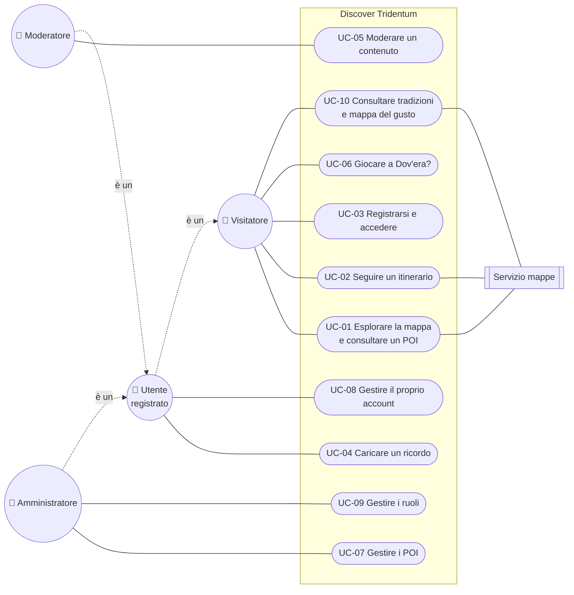

# Fase 2 — Specifiche Formali dei Requisiti (SRS Light)

**Progetto:** Discover Tridentum — Trento Nascosta
**Corso:** Ingegneria del Software · Prof. Paolo Giorgini · A.A. 2026-2027
**Team:** Manuel Bulla · Marco Buffa · Pietro Crea
**Versione:** 0.4 · **Stato:** Bozza
**Documento precedente:** [Fase 1 — Analisi del dominio](fase-1-analisi-dominio.md)
**Documento successivo:** [Fase 3 — Architettura e user flow](fase-3-architettura-user-flow.md)

### Storico delle revisioni

| Versione | Data | Autore | Modifiche |
|---|---|---|---|
| 0.1 | 30/09/2026 | Manuel Bulla | Prima stesura: RF con MoSCoW, RNF con metriche, 7 casi d'uso |
| 0.2 | 30/09/2026 | Manuel Bulla | Aggiunta la matrice di tracciabilità (§5); corretti i requisiti di UC-07; riordinati i flussi alternativi |
| 0.3 | 30/09/2026 | Manuel Bulla | Aggiunti UC-08, UC-09, UC-10: ora tutti i requisiti *Must* e *Should* hanno un caso d'uso |
| 0.4 | 01/10/2026 | Manuel Bulla | Priorità riviste: più peso ai luoghi (RF-04, RF-05, RF-07 da *Should* a *Must*), gioco in secondo piano (RF-21 da *Should* a *Could*) |

---

## Indice

1. [Introduzione](#1-introduzione)
2. [Requisiti funzionali](#2-requisiti-funzionali)
3. [Requisiti non funzionali](#3-requisiti-non-funzionali)
4. [Casi d'uso principali](#4-casi-duso-principali)
5. [Tracciabilità](#5-tracciabilità)
6. [Punti aperti](#6-punti-aperti)

---

## 1. Introduzione

### 1.1 Scopo

Questo documento specifica i requisiti della web app *Discover Tridentum*. Parte dai problemi e dai bisogni individuati nella Fase 1 e li trasforma in requisiti verificabili, ordinati per priorità.

### 1.2 Ambito del sistema

Il sistema è una **web app responsive**, pensata prima per smartphone, che permette di:

- esplorare su mappa i punti di interesse (POI) di Trento, compresi gli affreschi del centro storico;
- leggerne la storia, anche quella meno raccontata;
- seguire itinerari tematici o costruiti sul tempo disponibile;
- caricare foto e aneddoti (contenuti della community), pubblicati dopo moderazione;
- giocare a "Dov'era?", un minigame con foto storiche.

Sono **fuori ambito** in questa versione: app native per iOS/Android, prenotazioni e pagamenti, navigazione passo-passo.

### 1.3 Attori

| Attore | Descrizione |
|---|---|
| **Visitatore** | Chiunque apra la web app senza account: consulta mappa, schede e itinerari |
| **Utente registrato** | Visitatore con account: in più carica contenuti, gioca e salva preferiti |
| **Moderatore** | Utente registrato con il ruolo di approvare o rifiutare i contenuti della community |
| **Amministratore** | Gestisce POI, itinerari, utenti e ruoli |
| **Servizio mappe** *(sistema esterno)* | Fornisce le mappe di base e la geolocalizzazione (es. OpenStreetMap) |
| **Servizio e-mail** *(sistema esterno)* | Invia le e-mail di conferma, reimpostazione password e notifica |

### 1.4 Priorità MoSCoW

| Priorità | Significato |
|---|---|
| **M — Must** | Indispensabile: senza, il sistema non ha senso. Entra nella prima release. |
| **S — Should** | Importante, ma il sistema funziona anche senza. Entra se c'è tempo, subito dopo i Must. |
| **C — Could** | Desiderabile: si fa solo se avanza tempo. |
| **W — Won't** | Escluso da questa versione, in modo esplicito. Può tornare in futuro. |

---

## 2. Requisiti funzionali

Ogni requisito si legge come *"Il sistema deve permettere a …"*. La colonna **Bisogni** rimanda alla matrice di tracciabilità della Fase 1.

> Questa tabella **sostituisce** l'elenco preliminare di requisiti della Fase 1 (§4.2): i requisiti sono stati riorganizzati per area, rinumerati nel formato RF-XX e completati con quelli *Won't*.

### 2.1 Mappa e punti di interesse

| ID | Requisito | Attori | Priorità | Bisogni |
|---|---|---|---|---|
| **RF-01** | Mostrare una mappa interattiva dei POI, centrata sulla posizione dell'utente se concessa, altrimenti sul centro di Trento | Visitatore | **M** | B1, B11 |
| **RF-02** | Mostrare per ogni POI una scheda con nome, descrizione storica, immagini, indirizzo e fonti | Visitatore | **M** | B2, B8 |
| **RF-03** | Catalogare gli affreschi del centro storico come POI geolocalizzati, con autore, epoca e descrizione (se noti) | Visitatore | **M** | B3 |
| **RF-04** | Filtrare i POI per categoria (storia, arte, tradizioni, gastronomia) e per tema (es. Tridentum romana, guerra e ricostruzione, Adige) | Visitatore | **M** | B1, B2 |
| **RF-05** | Cercare un POI per nome o parola chiave | Visitatore | **M** | B2, B9 |
| **RF-06** | Inquadrare un monumento o un affresco con la fotocamera per aprirne la scheda | Visitatore | **C** | B2, B3 |

### 2.2 Itinerari

| ID | Requisito | Attori | Priorità | Bisogni |
|---|---|---|---|---|
| **RF-07** | Proporre itinerari tematici predefiniti, come sequenza ordinata di POI mostrata sulla mappa | Visitatore | **M** | B4, B11 |
| **RF-08** | Generare un itinerario in base al tempo disponibile (es. 2 ore, mezza giornata) e alla posizione di partenza | Visitatore | **C** | B4 |
| **RF-09** | Salvare POI e itinerari tra i preferiti | Utente registrato | **C** | B4 |

### 2.3 Account

| ID | Requisito | Attori | Priorità | Bisogni |
|---|---|---|---|---|
| **RF-10** | Registrarsi con e-mail e password, con accettazione dell'informativa privacy | Visitatore | **M** | B5, B6 |
| **RF-11** | Accedere, uscire e reimpostare la password | Utente registrato | **M** | B5 |
| **RF-12** | Vedere il proprio profilo con i contributi inviati e il loro stato (in attesa, approvato, rifiutato) | Utente registrato | **S** | B6 |
| **RF-13** | Eliminare il proprio account e i dati collegati | Utente registrato | **M** | B6 |

### 2.4 Contenuti della community

| ID | Requisito | Attori | Priorità | Bisogni |
|---|---|---|---|---|
| **RF-14** | Caricare una foto e/o un aneddoto collegato a un POI, indicando anno (anche approssimativo) e contesto | Utente registrato | **M** | B5 |
| **RF-15** | Scegliere la licenza d'uso del contenuto caricato e mostrarla con il nome dell'autore | Utente registrato | **S** | B6 |
| **RF-16** | Mettere in coda di moderazione ogni nuovo contenuto: nessun contenuto è pubblico prima dell'approvazione | Sistema, Moderatore | **M** | B6, B8 |
| **RF-17** | Approvare o rifiutare un contenuto, con motivazione in caso di rifiuto | Moderatore | **M** | B8 |
| **RF-18** | Segnalare un contenuto pubblicato come errato o inappropriato | Visitatore | **S** | B8 |

### 2.5 Cultura, gastronomia e gioco

| ID | Requisito | Attori | Priorità | Bisogni |
|---|---|---|---|---|
| **RF-19** | Mostrare una sezione su feste, usanze e tradizioni trentine, collegate a luoghi e periodi dell'anno | Visitatore | **S** | B1, B2 |
| **RF-20** | Mostrare una mappa dei locali con piatti tipici, con il piatto consigliato per ciascuno | Visitatore | **S** | B7 |
| **RF-21** | Giocare a "Dov'era?": vedere una foto storica, indicare il punto sulla mappa e ricevere un punteggio in base alla distanza | Visitatore | **C** | B10 |
| **RF-22** | Salvare i punteggi e mostrare una classifica | Utente registrato | **C** | B10 |
| **RF-23** | Usare le foto della community approvate come livelli del gioco, con il consenso dell'autore | Moderatore | **C** | B5, B10 |

### 2.6 Amministrazione

| ID | Requisito | Attori | Priorità | Bisogni |
|---|---|---|---|---|
| **RF-24** | Creare, modificare ed eliminare POI, affreschi, itinerari e voci della sezione tradizioni | Amministratore | **M** | B8, B11 |
| **RF-25** | Assegnare e revocare il ruolo di moderatore | Amministratore | **M** | B8 |

### 2.7 Esclusi da questa versione (Won't)

| ID | Requisito | Motivo dell'esclusione |
|---|---|---|
| **RF-26** | Navigazione passo-passo verso un POI | Già offerta da app esistenti: basta un link a un servizio di mappe esterno |
| **RF-27** | Prenotazione di tavoli, biglietti o visite guidate | Richiede accordi commerciali e pagamenti, fuori dallo scopo del corso |
| **RF-28** | Messaggistica tra utenti | Aumenta molto il lavoro di moderazione senza servire i bisogni principali |
| **RF-29** | Realtà aumentata sovrapposta alla fotocamera | Complessità tecnica troppo alta per i tempi del progetto |

### 2.8 Riepilogo

| Priorità | Quanti | Requisiti |
|---|---|---|
| **Must** | 14 | RF-01, 02, 03, 04, 05, 07, 10, 11, 13, 14, 16, 17, 24, 25 |
| **Should** | 5 | RF-12, 15, 18, 19, 20 |
| **Could** | 6 | RF-06, 08, 09, 21, 22, 23 |
| **Won't** | 4 | RF-26, 27, 28, 29 |

---

## 3. Requisiti non funzionali

Ogni requisito ha una **metrica** misurabile e un **metodo di verifica**.

### 3.1 Usabilità

| ID | Requisito | Metrica | Verifica | Priorità |
|---|---|---|---|---|
| **RNF-U01** | Interfaccia responsive, pensata prima per smartphone | Usabile da 360 px di larghezza in su, senza scroll orizzontale | Test su smartphone, tablet e desktop | **M** |
| **RNF-U02** | Caricare un contenuto deve essere semplice | Al massimo 3 passaggi dalla scheda del POI all'invio | Conteggio dei passaggi sul prototipo | **S** |
| **RNF-U03** | Un nuovo utente trova un POI vicino senza istruzioni | 4 utenti su 5 ci riescono entro 30 secondi | Test di usabilità con 5 persone | **S** |
| **RNF-U04** | Accessibilità | Linee guida WCAG 2.1 livello AA; punteggio Accessibilità di Lighthouse ≥ 90 | Lighthouse + controllo manuale | **S** |
| **RNF-U05** | Lingue | Interfaccia e schede principali in italiano e inglese; tedesco in seguito | Revisione dei testi | **S** |

### 3.2 Prestazioni

| ID | Requisito | Metrica | Verifica | Priorità |
|---|---|---|---|---|
| **RNF-P01** | Caricamento rapido della mappa | Mappa con i POI visibile in meno di 3 s su rete 4G | Lighthouse con simulazione rete mobile | **S** |
| **RNF-P02** | Apertura rapida delle schede | Scheda di un POI aperta in meno di 1,5 s dal tocco | Misura nel browser | **S** |
| **RNF-P03** | Immagini leggere | Foto caricate compresse a lato client; ogni immagine servita pesa al massimo 500 KB | Controllo dei file salvati | **S** |
| **RNF-P04** | Carico | Tempo di risposta del server sotto 1 s con 100 utenti contemporanei | Test di carico | **C** |

### 3.3 Sicurezza

| ID | Requisito | Metrica | Verifica | Priorità |
|---|---|---|---|---|
| **RNF-S01** | Comunicazioni cifrate | Tutto il traffico in HTTPS | Controllo della configurazione | **M** |
| **RNF-S02** | Password protette | Password salvate solo come hash con un algoritmo apposito (es. bcrypt o Argon2); minimo 8 caratteri | Revisione del codice | **M** |
| **RNF-S03** | Controllo degli accessi per ruolo | Ogni funzione di moderazione e amministrazione è negata a chi non ha il ruolo | Test automatici sulle API | **M** |
| **RNF-S04** | Conformità al GDPR | Informativa privacy, consenso esplicito, cancellazione dei dati entro 30 giorni dalla richiesta | Revisione con checklist GDPR | **M** |
| **RNF-S05** | Upload sicuri | Solo immagini JPEG/PNG/WebP fino a 10 MB; metadati personali (EXIF) rimossi prima della pubblicazione | Test con file non validi | **S** |
| **RNF-S06** | Protezione dagli abusi | Limite ai tentativi di accesso (es. 5 al minuto) e ai caricamenti per utente | Test automatici | **S** |

### 3.4 Portabilità

| ID | Requisito | Metrica | Verifica | Priorità |
|---|---|---|---|---|
| **RNF-PO01** | Compatibilità con i browser | Ultime 2 versioni di Chrome, Safari, Firefox ed Edge, anche su iOS e Android | Test manuali sui browser | **M** |
| **RNF-PO02** | Nessuna installazione richiesta | Si usa dal browser; installabile opzionalmente come PWA sulla schermata home | Controllo su smartphone | **C** |
| **RNF-PO03** | Ambiente replicabile | Il sistema si avvia su qualsiasi macchina con un solo comando (es. Docker Compose) | Avvio su una macchina pulita | **S** |
| **RNF-PO04** | Dati esportabili | POI e itinerari esportabili in formati aperti (JSON / GeoJSON) | Export e reimport | **C** |

### 3.5 Altri vincoli

| ID | Requisito | Priorità |
|---|---|---|
| **RNF-V01** | Ogni contenuto storico curato dal team indica almeno una fonte | **M** |
| **RNF-V02** | Le immagini dei beni culturali sono pubblicate nel rispetto delle norme sulla loro riproduzione (da verificare con la Soprintendenza) | **M** |
| **RNF-V03** | Il codice è versionato su GitHub, con README e istruzioni di avvio | **M** |

---

## 4. Casi d'uso principali

### 4.1 Diagramma dei casi d'uso

*Le frecce tratteggiate indicano la generalizzazione tra attori: un Moderatore è anche un Utente registrato, che a sua volta può fare tutto ciò che fa un Visitatore. Il diagramma completo, con le relazioni «include» ed «extend», è in [Fase 3 §2](fase-3-architettura-user-flow.md#2-diagramma-dei-casi-duso).*

---

### UC-01 — Esplorare la mappa e consultare un POI

| | |
|---|---|
| **Attore primario** | Visitatore |
| **Attori secondari** | Servizio mappe |
| **Descrizione** | Il visitatore guarda i POI intorno a sé e apre la scheda di uno di essi |
| **Pre-condizioni** | La web app è raggiungibile; nel sistema esiste almeno un POI pubblicato |
| **Post-condizioni** | Il visitatore vede la scheda completa del POI scelto |
| **Requisiti** | RF-01, RF-02, RF-03, RF-04, RF-05 · RNF-P01, RNF-P02 |

**Flusso principale**
1. Il visitatore apre la web app.
2. Il sistema chiede il permesso di usare la posizione.
3. Il visitatore concede il permesso.
4. Il sistema mostra la mappa centrata sulla posizione del visitatore, con i POI vicini.
5. Il visitatore tocca un POI sulla mappa.
6. Il sistema mostra un'anteprima (nome, foto, categoria).
7. Il visitatore apre la scheda completa.
8. Il sistema mostra descrizione storica, immagini, fonti e contenuti della community approvati.

**Flussi alternativi**
- **3a.** Il visitatore nega la posizione → il sistema centra la mappa su Piazza Duomo e prosegue dal passo 4.
- **5a.** Il visitatore applica un filtro per categoria o tema → il sistema mostra solo i POI corrispondenti e torna al passo 5.
- **5b.** Il visitatore cerca un POI per nome → il sistema mostra i risultati; il visitatore ne sceglie uno e si passa al passo 7.

**Eccezioni**
- **E1.** Il servizio mappe non risponde → il sistema mostra l'elenco dei POI in forma di lista, con un messaggio.
- **E2.** Connessione assente → il sistema avvisa che serve una connessione e propone di riprovare.
- **E3.** Nessun POI entro 1 km → il sistema allarga la vista fino a mostrare i POI più vicini.

---

### UC-02 — Seguire un itinerario

| | |
|---|---|
| **Attore primario** | Visitatore |
| **Attori secondari** | Servizio mappe |
| **Descrizione** | Il visitatore sceglie un itinerario tematico e lo segue tappa per tappa |
| **Pre-condizioni** | Esiste almeno un itinerario pubblicato |
| **Post-condizioni** | Il visitatore ha visto l'itinerario sulla mappa e le schede delle tappe |
| **Requisiti** | RF-07, RF-08, RF-09 |

**Flusso principale**
1. Il visitatore apre la sezione "Itinerari".
2. Il sistema mostra gli itinerari disponibili con tema, durata stimata e numero di tappe.
3. Il visitatore sceglie un itinerario.
4. Il sistema mostra il percorso sulla mappa, con le tappe numerate.
5. Il visitatore apre la prima tappa.
6. Il sistema mostra la scheda del POI e il pulsante "Prossima tappa".
7. Il visitatore passa alle tappe successive fino all'ultima.
8. Il sistema segnala la fine dell'itinerario e propone altri itinerari vicini.

**Flussi alternativi**
- **3a.** Il visitatore indica quanto tempo ha a disposizione → il sistema propone solo itinerari compatibili con quel tempo (RF-08).
- **7a.** Il visitatore vuole raggiungere una tappa → il sistema apre il servizio di mappe esterno con la destinazione impostata.
- **8a.** Il visitatore è un utente registrato → può salvare l'itinerario tra i preferiti (RF-09).

**Eccezioni**
- **E1.** Una tappa è stata rimossa → il sistema la salta e lo segnala.
- **E2.** Connessione assente → come UC-01 E2.

---

### UC-03 — Registrarsi e accedere

| | |
|---|---|
| **Attore primario** | Visitatore |
| **Attori secondari** | Servizio e-mail |
| **Descrizione** | Il visitatore crea un account per poter caricare contenuti, oppure accede a un account esistente |
| **Pre-condizioni** | Il visitatore non ha effettuato l'accesso |
| **Post-condizioni** | Il visitatore è autenticato come utente registrato |
| **Requisiti** | RF-10, RF-11 · RNF-S01, RNF-S02, RNF-S04, RNF-S06 |

**Flusso principale**
1. Il visitatore sceglie "Registrati".
2. Il sistema mostra il modulo: nome visualizzato, e-mail, password, accettazione dell'informativa privacy.
3. Il visitatore compila il modulo e conferma.
4. Il sistema controlla i dati e crea l'account.
5. Il sistema invia un'e-mail di conferma.
6. Il visitatore apre il link nell'e-mail.
7. Il sistema attiva l'account ed effettua l'accesso.

**Flussi alternativi**
- **1a.** Il visitatore ha già un account → sceglie "Accedi", inserisce e-mail e password, e il sistema effettua l'accesso.
- **1b.** Il visitatore ha dimenticato la password → sceglie "Password dimenticata" e riceve un link per reimpostarla.

**Eccezioni**
- **E1.** E-mail già registrata → il sistema lo segnala e propone di accedere o reimpostare la password.
- **E2.** Password troppo debole o informativa non accettata → il sistema indica il campo da correggere.
- **E3.** Credenziali errate per 5 volte in un minuto → il sistema blocca temporaneamente i tentativi.
- **E4.** Link di conferma scaduto → il sistema permette di richiederne uno nuovo.

---

### UC-04 — Caricare un ricordo

| | |
|---|---|
| **Attore primario** | Utente registrato |
| **Attori secondari** | Moderatore (riceve il contenuto in coda) |
| **Descrizione** | L'utente carica una foto e/o un aneddoto collegato a un POI |
| **Pre-condizioni** | L'utente ha effettuato l'accesso; il POI esiste |
| **Post-condizioni** | Il contenuto è salvato con stato "in attesa" ed è nella coda di moderazione; non è ancora pubblico |
| **Requisiti** | RF-14, RF-15, RF-16 · RNF-U02, RNF-P03, RNF-S05 |

**Flusso principale**
1. L'utente apre la scheda di un POI e sceglie "Aggiungi un ricordo".
2. Il sistema mostra il modulo: foto, testo, anno (anche approssimativo), licenza d'uso.
3. L'utente allega una foto, scrive l'aneddoto, indica l'anno e sceglie la licenza.
4. L'utente invia.
5. Il sistema controlla il file, lo comprime e rimuove i metadati personali.
6. Il sistema salva il contenuto con stato "in attesa" e lo mette in coda di moderazione.
7. Il sistema conferma l'invio e spiega che il contenuto sarà visibile dopo la verifica.

**Flussi alternativi**
- **1a.** L'utente non ha effettuato l'accesso → il sistema lo porta a UC-03 e poi torna al passo 2.
- **3a.** L'utente carica solo il testo, senza foto → si prosegue dal passo 4 (il testo è obbligatorio se manca la foto).

**Eccezioni**
- **E1.** Il file non è un'immagine valida o supera 10 MB → il sistema rifiuta il file e spiega perché.
- **E2.** Mancano sia foto sia testo → il sistema non permette l'invio.
- **E3.** L'utente ha superato il limite di caricamenti → il sistema chiede di riprovare più tardi.
- **E4.** Il caricamento si interrompe → il sistema conserva i dati inseriti e propone di riprovare.

---

### UC-05 — Moderare un contenuto

| | |
|---|---|
| **Attore primario** | Moderatore |
| **Descrizione** | Il moderatore verifica un contenuto della community e decide se pubblicarlo |
| **Pre-condizioni** | Il moderatore ha effettuato l'accesso con il ruolo di moderatore; in coda c'è almeno un contenuto |
| **Post-condizioni** | Il contenuto è "approvato" (visibile nella scheda) oppure "rifiutato" (con motivazione); l'autore vede lo stato nel profilo |
| **Requisiti** | RF-12, RF-16, RF-17, RF-18 · RNF-S03 |

**Flusso principale**
1. Il moderatore apre la coda di moderazione.
2. Il sistema mostra i contenuti in attesa, dal più vecchio.
3. Il moderatore apre un contenuto.
4. Il sistema mostra foto, testo, anno, licenza, autore e POI collegato.
5. Il moderatore verifica pertinenza, correttezza e rispetto delle regole.
6. Il moderatore approva.
7. Il sistema pubblica il contenuto nella scheda del POI e aggiorna lo stato nel profilo dell'autore.

**Flussi alternativi**
- **1a.** Il moderatore apre la coda delle segnalazioni (RF-18) → verifica il contenuto segnalato e decide se lasciarlo pubblicato o rimuoverlo.
- **6a.** Il moderatore rifiuta → il sistema chiede una motivazione, la salva e la mostra all'autore.

**Eccezioni**
- **E1.** Due moderatori aprono lo stesso contenuto → vale la prima decisione salvata; il secondo riceve un avviso.
- **E2.** L'utente non ha il ruolo di moderatore → il sistema nega l'accesso alla coda.

---

### UC-06 — Giocare a "Dov'era?"

| | |
|---|---|
| **Attore primario** | Visitatore |
| **Descrizione** | Il visitatore vede una foto storica e cerca di indovinare dove è stata scattata |
| **Pre-condizioni** | Esistono almeno 5 foto storiche geolocalizzate abilitate per il gioco |
| **Post-condizioni** | Il visitatore conosce il proprio punteggio; se registrato, il punteggio è salvato |
| **Requisiti** | RF-21, RF-22, RF-23 |

**Flusso principale**
1. Il visitatore apre "Dov'era?" e avvia una partita.
2. Il sistema mostra una foto storica e una mappa di Trento.
3. Il visitatore mette un segnaposto sulla mappa e conferma.
4. Il sistema mostra la posizione reale, la distanza e i punti ottenuti, con un link alla scheda del POI.
5. Si ripetono i passi 2–4 per 5 foto.
6. Il sistema mostra il punteggio finale.

**Flussi alternativi**
- **6a.** Il visitatore è un utente registrato → il sistema salva il punteggio e mostra la sua posizione in classifica (RF-22).
- **4a.** Il visitatore apre la scheda del POI → il gioco va in pausa e riprende al ritorno.

**Eccezioni**
- **E1.** Foto disponibili meno di 5 → il sistema mostra un messaggio e non avvia la partita.
- **E2.** Il visitatore esce a metà partita → la partita non viene salvata.

---

### UC-07 — Gestire i POI

| | |
|---|---|
| **Attore primario** | Amministratore |
| **Descrizione** | L'amministratore crea, modifica o elimina un POI (anche un affresco) |
| **Pre-condizioni** | L'amministratore ha effettuato l'accesso con il ruolo di amministratore |
| **Post-condizioni** | Il POI è salvato, aggiornato o rimosso ed è subito visibile (o non più visibile) sulla mappa |
| **Requisiti** | RF-24 · RNF-S03, RNF-V01 |

**Flusso principale**
1. L'amministratore apre il pannello di gestione e sceglie "Nuovo POI".
2. Il sistema mostra il modulo: nome, categoria, temi, posizione, descrizione, immagini, fonti.
3. L'amministratore compila il modulo e fissa la posizione sulla mappa.
4. L'amministratore salva.
5. Il sistema controlla i campi obbligatori e salva il POI.
6. Il POI compare sulla mappa pubblica.

**Flussi alternativi**
- **1a.** Modifica di un POI esistente → l'amministratore lo cerca, lo apre, cambia i campi e salva.
- **1b.** Eliminazione di un POI → il sistema chiede conferma, avvisando se il POI è una tappa di un itinerario.

**Eccezioni**
- **E1.** Manca un campo obbligatorio (nome, posizione, almeno una fonte) → il sistema non salva e indica il campo.
- **E2.** Esiste già un POI con lo stesso nome a meno di 20 m → il sistema chiede conferma prima di salvare.

---

### UC-08 — Gestire il proprio account

| | |
|---|---|
| **Attore primario** | Utente registrato |
| **Attori secondari** | Servizio e-mail |
| **Descrizione** | L'utente consulta il proprio profilo e lo stato dei contributi, oppure elimina l'account |
| **Pre-condizioni** | L'utente ha effettuato l'accesso |
| **Post-condizioni** | L'utente ha visto il proprio profilo, oppure l'account è disattivato e i dati personali saranno cancellati entro 30 giorni |
| **Requisiti** | RF-09, RF-12, RF-13 · RNF-S04 |

**Flusso principale**
1. L'utente apre "Profilo".
2. Il sistema mostra nome visualizzato, preferiti e contributi inviati con il loro stato (in attesa, approvato, rifiutato).
3. L'utente sceglie "Elimina account".
4. Il sistema spiega le conseguenze e chiede se i contributi già pubblicati vanno rimossi o lasciati in forma anonima.
5. L'utente sceglie e conferma inserendo la password.
6. Il sistema disattiva subito l'account, chiude la sessione e pianifica la cancellazione dei dati personali.
7. Il sistema invia un'e-mail di conferma.

**Flussi alternativi**
- **3a.** L'utente apre un contributo rifiutato → il sistema mostra la motivazione del moderatore (RF-17).
- **5a.** L'utente annulla → il sistema torna al profilo senza modifiche.

**Eccezioni**
- **E1.** Password errata → il sistema non procede e permette di riprovare.
- **E2.** L'utente è l'unico amministratore → il sistema blocca l'eliminazione finché non viene nominato un altro amministratore.

---

### UC-09 — Gestire i ruoli

| | |
|---|---|
| **Attore primario** | Amministratore |
| **Descrizione** | L'amministratore assegna o revoca il ruolo di moderatore a un utente registrato |
| **Pre-condizioni** | L'amministratore ha effettuato l'accesso con il ruolo di amministratore |
| **Post-condizioni** | Il ruolo dell'utente è aggiornato e vale dalla richiesta successiva dell'utente |
| **Requisiti** | RF-25 · RNF-S03 |

**Flusso principale**
1. L'amministratore apre il pannello di gestione e sceglie "Utenti".
2. L'amministratore cerca un utente per nome visualizzato o e-mail.
3. Il sistema mostra l'utente con il suo ruolo attuale.
4. L'amministratore assegna il ruolo di moderatore.
5. Il sistema salva il nuovo ruolo e avvisa l'utente.

**Flussi alternativi**
- **4a.** L'amministratore revoca il ruolo → i contenuti che quel moderatore stava verificando tornano in coda.

**Eccezioni**
- **E1.** Nessun utente corrisponde alla ricerca → il sistema lo segnala.
- **E2.** L'utente è stato eliminato nel frattempo → il sistema annulla l'operazione e aggiorna l'elenco.

---

### UC-10 — Consultare tradizioni e mappa del gusto

| | |
|---|---|
| **Attore primario** | Visitatore |
| **Attori secondari** | Servizio mappe |
| **Descrizione** | Il visitatore scopre feste e tradizioni trentine oppure i locali con piatti tipici |
| **Pre-condizioni** | Esiste almeno una voce pubblicata nella sezione scelta |
| **Post-condizioni** | Il visitatore ha visto la voce scelta e i luoghi collegati |
| **Requisiti** | RF-19, RF-20 |

**Flusso principale**
1. Il visitatore apre "Scopri".
2. Il sistema mostra le due sezioni: "Tradizioni" e "Mappa del gusto".
3. Il visitatore sceglie "Tradizioni".
4. Il sistema mostra le voci ordinate per periodo dell'anno, mettendo in evidenza quelle in corso o vicine.
5. Il visitatore apre una voce.
6. Il sistema mostra descrizione, periodo e luoghi collegati sulla mappa; dai luoghi si apre la scheda del POI (UC-01, passi 7–8).

**Flussi alternativi**
- **3a.** Il visitatore sceglie "Mappa del gusto" → il sistema mostra sulla mappa i locali con il piatto consigliato; toccando un locale si apre la sua scheda (UC-01, passi 6–8).

**Eccezioni**
- **E1.** Nessuna tradizione nel periodo corrente → il sistema mostra tutte le voci dell'anno.
- **E2.** Il servizio mappe non risponde → come UC-01 E1.

---

## 5. Tracciabilità

### 5.1 Corrispondenza con la Fase 1

I requisiti preliminari della Fase 1 (§4.2) sono stati rinumerati e, in alcuni casi, divisi.

| Fase 1 | Fase 2 | Note |
|---|---|---|
| RF01 | RF-01 | |
| RF02 | RF-02 | |
| RF03 | RF-03 | |
| RF04 | RF-06 | |
| RF05 | RF-04 | |
| RF06 | RF-07, RF-08 | Diviso: itinerari tematici (S) e itinerari sul tempo disponibile (C) |
| RF07 | RF-10, RF-11 | Diviso: registrazione e accesso |
| RF08 | RF-14 | |
| RF09 | RF-16, RF-17 | Diviso: coda di moderazione e decisione del moderatore |
| RF10 | RF-15 | |
| RF11 | RF-19 | |
| RF12 | RF-20 | |
| RF13 | RF-21 | |
| RF14 | RF-23 | |
| RF15 | RF-24 | |
| — | RF-05, RF-09, RF-12, RF-13, RF-18, RF-22, RF-25 | Nuovi in Fase 2 |
| — | RF-26 … RF-29 | Nuovi in Fase 2 (*Won't*) |
| RNF01 | RNF-U01 | |
| RNF02 | RNF-U02 | |
| RNF03 | RNF-S04 | |
| RNF04 | RNF-V02 | |
| RNF05 | RNF-U04 | |
| RNF06 | RNF-U05 | |
| RNF07 | RNF-P01 | |

### 5.2 Copertura dei bisogni

Ogni bisogno della Fase 1 è coperto da almeno un requisito.

| Bisogno | Requisiti funzionali | Requisiti non funzionali |
|---|---|---|
| **B1** Luoghi oltre le attrazioni principali | RF-01, RF-04, RF-19 | — |
| **B2** Storia sul posto | RF-02, RF-04, RF-05, RF-06, RF-19 | RNF-U01, RNF-P01, RNF-P02 |
| **B3** Affreschi | RF-03, RF-06 | — |
| **B4** Organizzare il tempo | RF-07, RF-08, RF-09 | — |
| **B5** Condividere foto e ricordi | RF-10, RF-11, RF-14, RF-23 | — |
| **B6** Riconoscimento e tutela | RF-10, RF-12, RF-13, RF-15, RF-16 | RNF-S04, RNF-S05, RNF-V02 |
| **B7** Piatti tipici | RF-20 | — |
| **B8** Affidabilità delle informazioni | RF-02, RF-16, RF-17, RF-18, RF-24, RF-25 | RNF-V01, RNF-V02 |
| **B9** Facilità d'uso | RF-05 | RNF-U01, RNF-U02, RNF-U03, RNF-U04 |
| **B10** Scoperta coinvolgente | RF-21, RF-22, RF-23 | — |
| **B11** Distribuire i flussi | RF-01, RF-07, RF-24 | — |
| **B12** Altre lingue | — | RNF-U05 |

### 5.3 Requisiti ↔ casi d'uso

| Caso d'uso | Requisiti funzionali |
|---|---|
| UC-01 Esplorare la mappa e consultare un POI | RF-01, RF-02, RF-03, RF-04, RF-05 |
| UC-02 Seguire un itinerario | RF-07, RF-08, RF-09 |
| UC-03 Registrarsi e accedere | RF-10, RF-11 |
| UC-04 Caricare un ricordo | RF-14, RF-15, RF-16 |
| UC-05 Moderare un contenuto | RF-12, RF-16, RF-17, RF-18 |
| UC-06 Giocare a "Dov'era?" | RF-21, RF-22, RF-23 |
| UC-07 Gestire i POI | RF-24 |
| UC-08 Gestire il proprio account | RF-09, RF-12, RF-13 |
| UC-09 Gestire i ruoli | RF-25 |
| UC-10 Consultare tradizioni e mappa del gusto | RF-19, RF-20 |

Tutti i requisiti *Must* e *Should* sono descritti da almeno un caso d'uso. RF-06 (*Could*) compare come estensione di UC-01 nel diagramma completo della [Fase 3](fase-3-architettura-user-flow.md#2-diagramma-dei-casi-duso); RF-26 … RF-29 (*Won't*) non richiedono un caso d'uso in questa versione.

---

## 6. Punti aperti

- **RF-06 (fotocamera):** resta *Could*; l'architettura lo affida all'AI Service ([Fase 3 §5.4](fase-3-architettura-user-flow.md#54-ai-service)).
- **Moderatori:** chi sono, in pratica? Team, volontari, un'associazione o un museo partner.
- **Licenze dei contenuti:** quali proporre agli utenti (es. Creative Commons BY, BY-NC, "tutti i diritti riservati").
- **Servizio mappe:** proposta OpenStreetMap con Leaflet ([Fase 3 §6](fase-3-architettura-user-flow.md#6-decisioni-architetturali)); da confermare dal team.
- **Immagini dei beni culturali (RNF-V02):** verificare con la Soprintendenza cosa si può pubblicare.
