# Fase 3 — Architettura del Sistema e User Flow

**Progetto:** Discover Tridentum — Trento Nascosta
**Corso:** Ingegneria del Software · Prof. Paolo Giorgini · A.A. 2026-2027
**Team:** Manuel Bulla · Marco Buffa · Pietro Crea
**Versione:** 0.2 · **Stato:** Bozza
**Documento precedente:** [Fase 2 — Specifiche dei requisiti](fase-2-specifiche-requisiti.md)
**Documento successivo:** [Fase 4 — Pianificazione dello sviluppo](fase-4-pianificazione.md)

### Storico delle revisioni

| Versione | Data | Autore | Modifiche |
|---|---|---|---|
| 0.1 | 30/09/2026 | Manuel Bulla | Prima stesura: casi d'uso, user flow, architettura ad alto livello |
| 0.2 | 09/10/2026 | Manuel Bulla | Decisioni prese realizzando l'MVP (D-10…D-14) e stack adottato; vista di deployment dell'MVP |

---

## Indice

1. [Introduzione](#1-introduzione)
2. [Diagramma dei casi d'uso](#2-diagramma-dei-casi-duso)
3. [User journey e flusso delle schermate](#3-user-journey-e-flusso-delle-schermate)
4. [Architettura ad alto livello](#4-architettura-ad-alto-livello)
5. [Componenti](#5-componenti)
6. [Decisioni architetturali](#6-decisioni-architetturali)
7. [Scenari dinamici](#7-scenari-dinamici)
8. [Vista di deployment](#8-vista-di-deployment)
9. [Tracciabilità](#9-tracciabilità)
10. [Punti aperti](#10-punti-aperti)

---

## 1. Introduzione

### 1.1 Scopo

Questo documento descrive **come** il sistema soddisfa i requisiti della Fase 2:

- quali funzionalità offre e a chi (diagramma dei casi d'uso);
- come l'utente si muove tra le schermate, dall'apertura dell'app alla consultazione di un luogo (user flow);
- da quali componenti è fatto il sistema e come comunicano (architettura ad alto livello).

### 1.2 Identificatori introdotti

| Elemento | Formato | Esempio |
|---|---|---|
| Schermata | `S-nn` | S-03 Scheda POI |
| Decisione architetturale | `D-nn` | D-05 Database geografico |

Gli altri identificatori (P, B, RF, RNF, UC) sono quelli delle Fasi 1 e 2.

---

## 2. Diagramma dei casi d'uso

Il diagramma riprende i dieci casi d'uso della [Fase 2](fase-2-specifiche-requisiti.md#4-casi-duso-principali). Per leggibilità è diviso in due viste: la prima mostra chi fa cosa, la seconda le relazioni tra i casi d'uso.

### 2.1 Vista generale: attori e casi d'uso

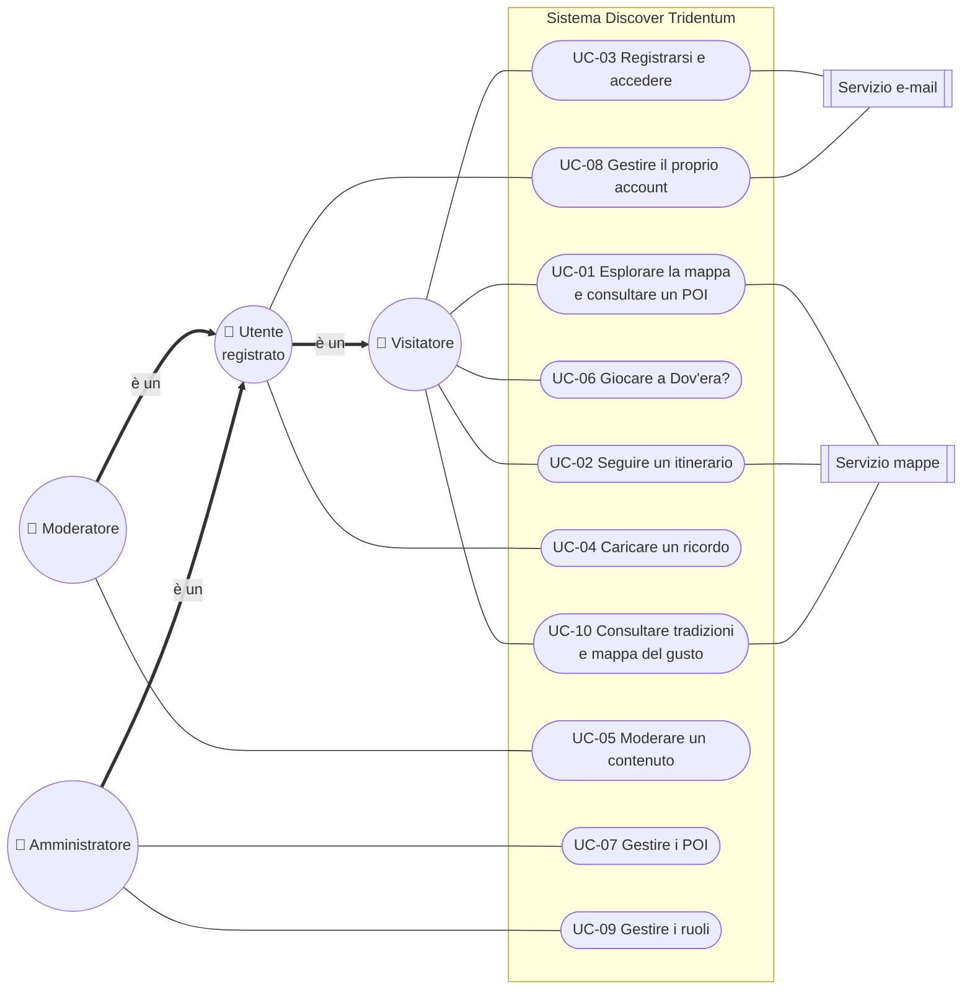

### 2.2 Vista di dettaglio: «include» ed «extend»

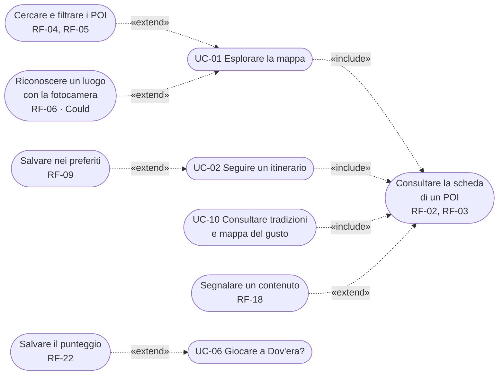

**Legenda**
- **Linea continua**: associazione tra attore e caso d'uso.
- **Freccia doppia "è un"**: generalizzazione tra attori. Un Moderatore e un Amministratore sono anche Utenti registrati; un Utente registrato può fare tutto ciò che fa un Visitatore.
- **«include»**: il caso d'uso base contiene *sempre* quello incluso (la freccia va dal caso base a quello incluso).
- **«extend»**: il caso d'uso che estende si attiva *solo a una condizione*, nel punto indicato del caso base (la freccia va dall'estensione al caso base).

I casi d'uso inclusi o estesi corrispondono a passi o flussi alternativi già descritti nella Fase 2; per questo non hanno un ID `UC-nn` proprio.

| Relazione | Condizione / punto del caso base | Riferimento in Fase 2 |
|---|---|---|
| UC-01, UC-02, UC-10 «include» *Consultare la scheda di un POI* | Apertura della scheda | UC-01 passi 7–8 · UC-02 passo 6 · UC-10 passo 6 |
| *Cercare e filtrare i POI* «extend» UC-01 | Il visitatore usa la ricerca o i filtri | UC-01 flussi 5a, 5b |
| *Riconoscere un luogo con la fotocamera* «extend» UC-01 | Il visitatore inquadra un luogo (solo se RF-06 viene realizzato) | RF-06 |
| *Segnalare un contenuto* «extend» *Consultare la scheda* | Il visitatore ritiene errato un contenuto | UC-05 flusso 1a |
| *Salvare nei preferiti* «extend» UC-02 | L'utente è registrato | UC-02 flusso 8a |
| *Salvare il punteggio* «extend» UC-06 | L'utente è registrato, a fine partita | UC-06 flusso 6a |

> **Nota.** UC-04 richiede che l'utente abbia effettuato l'accesso: è una **pre-condizione**, non un «include» di UC-03 (se l'utente è già autenticato, UC-03 non viene eseguito).

---

## 3. User journey e flusso delle schermate

### 3.1 Principi di navigazione

1. **Si consulta senza account.** La registrazione si chiede solo quando serve: caricare un ricordo, salvare preferiti o punteggi (B9, persona *Giulia*).
2. **La mappa è la schermata iniziale.** Tutto parte da "cosa c'è intorno a me".
3. **Al massimo 2 tocchi dalla mappa alla scheda** di un luogo (S-01 → S-02 → S-03).
4. **Barra di navigazione fissa in basso** con 5 voci, usabile con una mano sola (RNF-U01).
5. **Le aree riservate** (moderazione, amministrazione) si raggiungono dal Profilo e sono visibili solo a chi ha il ruolo (RNF-S03).
6. **Nessun vicolo cieco.** Ogni errore propone un'alternativa: niente mappa → elenco; niente riconoscimento → ricerca.

### 3.2 Elenco delle schermate

| ID | Schermata | Contenuto principale | Requisiti | Chi la vede |
|---|---|---|---|---|
| **S-00** | Benvenuto | Scelta della lingua, due schede su cosa offre l'app, spiegazione della richiesta di posizione | RNF-U05 | Tutti, solo al primo accesso |
| **S-01** | Mappa | Mappa con i POI raggruppati, pulsante "la mia posizione", barra di ricerca, filtri per categoria e tema | RF-01, RF-03, RF-04 | Tutti |
| **S-01L** | Elenco dei POI | Versione a lista della mappa, quando il servizio mappe non risponde | UC-01 E1 | Tutti |
| **S-02** | Anteprima POI | Riquadro dal basso: nome, foto, categoria, distanza | RF-01 | Tutti |
| **S-03** | Scheda POI | Storia, immagini, fonti, ricordi approvati con autore e licenza; pulsanti "Aggiungi un ricordo", "Come arrivare" (link esterno), "Salva", "Segnala" | RF-02, RF-03, RF-15, RF-18 | Tutti |
| **S-04** | Ricerca e filtri | Ricerca per nome o parola chiave, filtri combinabili | RF-04, RF-05 | Tutti |
| **S-05** | Itinerari | Elenco con tema, durata e numero di tappe; filtro "ho … ore" | RF-07, RF-08 | Tutti |
| **S-06** | Itinerario | Percorso sulla mappa, tappe numerate, "Prossima tappa" | RF-07, RF-09 | Tutti |
| **S-07** | Accedi / Registrati | Due schede: accesso e registrazione (4 campi); "Password dimenticata" | RF-10, RF-11 | Chi non ha fatto l'accesso |
| **S-08** | Aggiungi un ricordo | Foto, testo, anno, licenza; invio in 3 passaggi al massimo | RF-14, RF-15, RNF-U02 | Utenti registrati |
| **S-09** | Profilo | Contributi con stato, preferiti, impostazioni, eliminazione account; accesso alle aree di ruolo | RF-09, RF-12, RF-13 | Utenti registrati |
| **S-10** | Dov'era? | Foto storica, mappa per il segnaposto, punteggio, classifica | RF-21, RF-22 | Tutti (classifica: registrati) |
| **S-11** | Scopri | Due schede: "Tradizioni" (per periodo dell'anno) e "Mappa del gusto" | RF-19, RF-20 | Tutti |
| **S-12** | Fotocamera | Inquadratura e risultato del riconoscimento | RF-06 (*Could*) | Tutti |
| **S-13** | Moderazione | Coda dei contenuti in attesa e delle segnalazioni, con il pre-controllo automatico | RF-16, RF-17, RF-18 | Moderatori |
| **S-14** | Amministrazione | Gestione di POI, itinerari, tradizioni, utenti e ruoli | RF-24, RF-25 | Amministratori |

### 3.3 Flusso dall'accesso alla consultazione

Il flusso parte dall'apertura della web app e arriva alla scheda di un luogo, con i rami per l'accesso (quando l'utente vuole contribuire) e per gli errori.

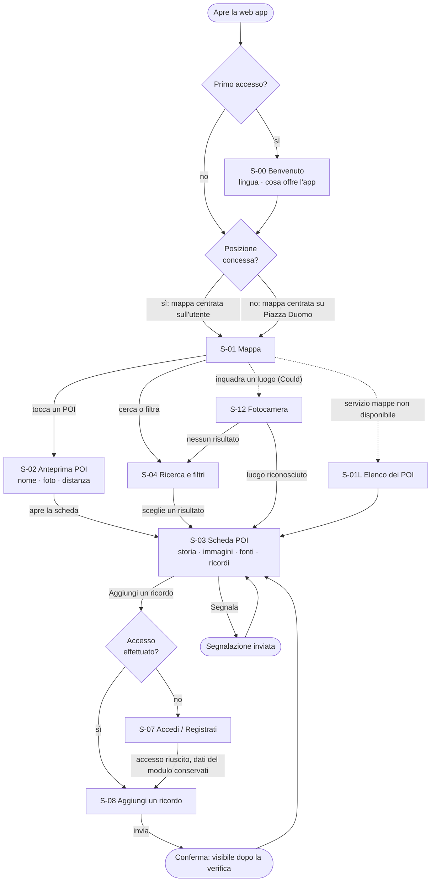

### 3.4 Mappa di navigazione

Dalla barra di navigazione si raggiungono tutte le sezioni; tutte portano alla scheda del POI, che è il centro dell'app.

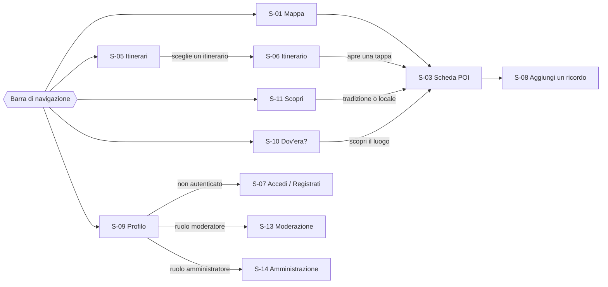

### 3.5 User journey delle personas

I punteggi (da 1 = frustrante a 5 = soddisfacente) indicano come si sente la persona in ogni momento. I momenti con punteggio basso sono quelli su cui il design deve intervenire (§3.6).

**Giulia — turista** ([Fase 1 §2.1](fase-1-analisi-dominio.md#21-persona-a--il-turista-giulia))

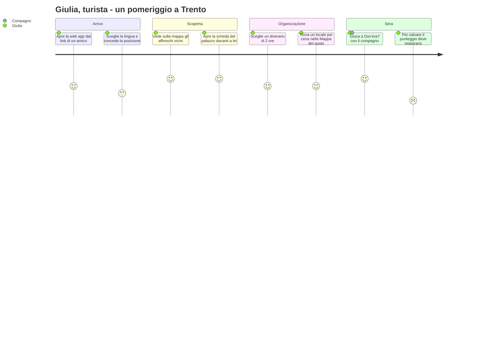

**Franco — residente** ([Fase 1 §2.2](fase-1-analisi-dominio.md#22-persona-b--il-residente-franco))

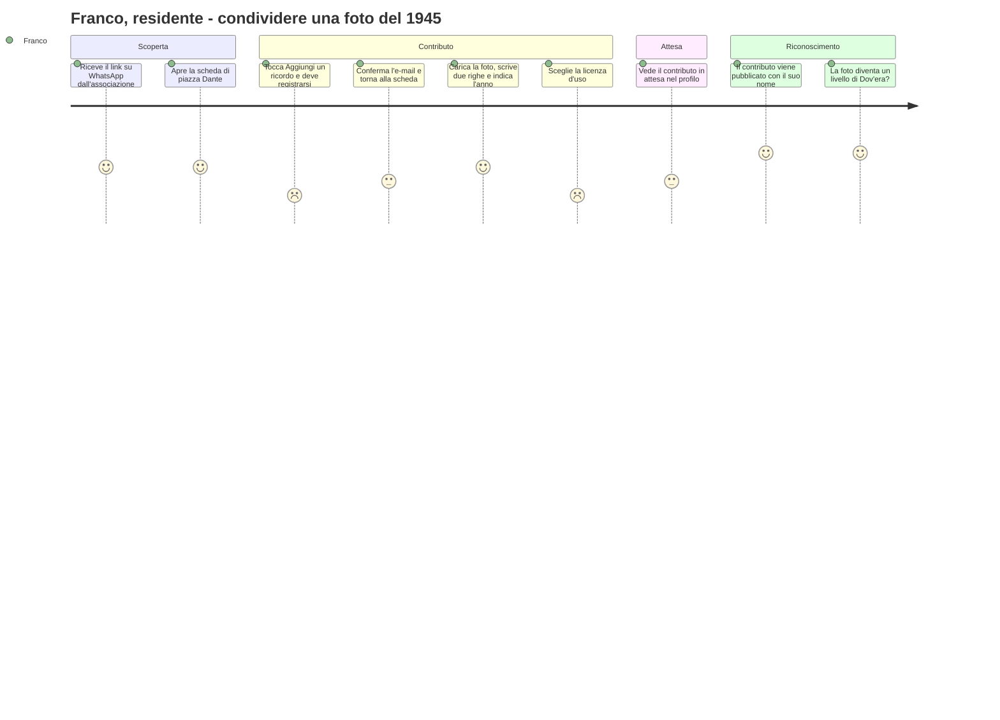

### 3.6 Momenti critici e risposte di design

| Momento | Persona | Problema | Risposta di design |
|---|---|---|---|
| Richiesta della posizione | Giulia | Il browser chiede il permesso senza spiegare perché | S-00 spiega a cosa serve *prima* della richiesta del browser; se la posizione è negata, la mappa parte da Piazza Duomo (UC-01 3a) |
| Registrazione per salvare il punteggio | Giulia | Perdere la partita appena giocata | Il punteggio resta in memoria e viene salvato subito dopo la registrazione |
| Registrazione a metà contributo | Franco | Modulo lungo, paura di perdere quanto scritto | Registrazione con 4 campi; i dati di S-08 vengono conservati e dopo la conferma l'utente torna al modulo (UC-04 1a) |
| Scelta della licenza | Franco | Termini tecnici poco chiari | Ogni licenza spiegata con una frase semplice ("chiunque può riusarla citandoti") e un'opzione predefinita consigliata |
| Attesa della moderazione | Franco | Non sapere se il contributo è arrivato | Stato visibile nel profilo (RF-12) ed e-mail all'approvazione o al rifiuto |

---

## 4. Architettura ad alto livello

### 4.1 Diagramma dei componenti

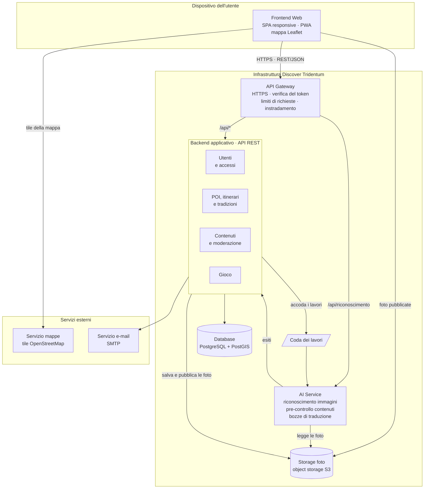

### 4.2 Stile architetturale

Il sistema segue un'architettura **client–server a livelli**, con:

- un **API Gateway** come unico punto d'ingresso: il frontend conosce un solo indirizzo e la sicurezza è concentrata in un punto;
- un **backend a monolite modulare**: un'unica applicazione divisa in moduli con confini netti, adatta a un team di 3 persone e ai tempi del corso (D-02);
- un **AI Service separato**, perché usa tecnologie e risorse diverse e, se si guasta, il resto del sistema continua a funzionare (D-03);
- **dati e file separati**: i dati strutturati nel database, le foto in uno storage dedicato (D-06).

### 4.3 Comunicazione tra i componenti

| Da → A | Protocollo | Modalità | Contenuto |
|---|---|---|---|
| Frontend → API Gateway | HTTPS, REST/JSON | Sincrona | Tutte le richieste all'applicazione |
| Frontend → Servizio mappe | HTTPS | Sincrona | Tile della mappa di base |
| Frontend → Storage foto | HTTPS | Sincrona | Download delle foto pubblicate (URL pubblici) |
| API Gateway → Backend | HTTP (rete interna) | Sincrona | Richieste instradate, con l'identità dell'utente già verificata |
| API Gateway → AI Service | HTTP (rete interna) | Sincrona | Riconoscimento di un'immagine (RF-06) |
| Backend → Coda → AI Service | Coda di lavori | **Asincrona** | Pre-controllo dei contenuti, aggiornamento dell'indice delle immagini, bozze di traduzione |
| AI Service → Backend | HTTP (rete interna) | Asincrona | Esiti dei lavori |
| Backend → Database | SQL | Sincrona | Lettura e scrittura dei dati |
| Backend → Servizio e-mail | SMTP | Asincrona | Conferme, reimpostazione password, notifiche |

Il frontend non parla mai direttamente con il backend, l'AI Service o il database.

---

## 5. Componenti

### 5.1 Frontend Web

**Responsabilità**
- Interfaccia utente di tutte le schermate (§3.2), pensata prima per smartphone.
- Mappa interattiva con Leaflet e raggruppamento dei POI vicini (*clustering*), per restare veloce anche con molti punti.
- Compressione delle foto *prima* dell'invio (RNF-P03).
- Testi in italiano e inglese (RNF-U05).
- Installabile come PWA (RNF-PO02).

**Tecnologia proposta:** React + Vite, Leaflet, i18next.
**Requisiti principali:** RNF-U01…U05, RNF-P01, RNF-P02, RNF-PO01, RNF-PO02.

### 5.2 API Gateway

**Responsabilità**
- **HTTPS** per tutto il traffico (RNF-S01).
- **Verifica del token** di accesso e controllo del ruolo per le aree riservate: `/api/moderazione/*` solo ai moderatori, `/api/admin/*` solo agli amministratori (RNF-S03).
- **Limiti di richieste**: 5 tentativi di accesso al minuto, numero massimo di caricamenti per utente, limite sul riconoscimento immagini (RNF-S06).
- **Instradamento** verso il backend o l'AI Service.
- Unico punto dove si registrano gli accessi (log).

**Tecnologia proposta:** Node.js + Express con middleware di proxy, verifica JWT e rate limiting (alternativa: Traefik o Kong).
**Requisiti principali:** RNF-S01, RNF-S03, RNF-S06.

**Principali endpoint esposti**

| Metodo e percorso | Scopo | Ruolo richiesto | UC |
|---|---|---|---|
| `GET /api/poi?bbox=…&categoria=…&tema=…` | POI visibili nell'area della mappa | — | UC-01, UC-10 |
| `GET /api/poi/{id}` | Scheda di un POI con i ricordi approvati | — | UC-01 |
| `GET /api/poi/cerca?q=…` | Ricerca per nome o parola chiave | — | UC-01 |
| `GET /api/itinerari?durata_max=…` · `GET /api/itinerari/{id}` | Elenco e dettaglio degli itinerari | — | UC-02 |
| `GET /api/tradizioni` | Tradizioni per periodo dell'anno | — | UC-10 |
| `POST /api/auth/registrazione` · `/accesso` · `/password-dimenticata` | Account | — | UC-03 |
| `GET /api/me` · `DELETE /api/me` | Profilo ed eliminazione dell'account | Utente | UC-08 |
| `POST /api/poi/{id}/contenuti` | Caricare un ricordo | Utente | UC-04 |
| `POST /api/contenuti/{id}/segnalazioni` | Segnalare un contenuto | — | UC-01 |
| `GET /api/moderazione/coda` · `POST /api/moderazione/{id}/decisione` | Moderazione | Moderatore | UC-05 |
| `GET /api/gioco/partita` · `POST /api/gioco/punteggi` | Partita e salvataggio del punteggio | — / Utente | UC-06 |
| `POST · PUT · DELETE /api/admin/poi/…` | Gestione dei POI | Amministratore | UC-07 |
| `PUT /api/admin/utenti/{id}/ruolo` | Assegnare o revocare un ruolo | Amministratore | UC-09 |
| `POST /api/riconoscimento` | Riconoscere un luogo da una foto | — | RF-06 |

### 5.3 Backend applicativo

Un'unica applicazione con quattro moduli. Ogni modulo gestisce i propri dati e li espone agli altri solo tramite interfacce interne, così in futuro un modulo si può estrarre come servizio a sé.

| Modulo | Responsabilità | Requisiti |
|---|---|---|
| **Utenti e accessi** | Registrazione, accesso, token, password (hash con Argon2 o bcrypt), ruoli, eliminazione dei dati entro 30 giorni | RF-10…RF-13, RF-25 · RNF-S02, RNF-S04 |
| **POI, itinerari e tradizioni** | Schede, ricerca, filtri, query geografiche, itinerari, tradizioni, locali, preferiti, export GeoJSON | RF-01…RF-05, RF-07…RF-09, RF-19, RF-20, RF-24 · RNF-V01, RNF-PO04 |
| **Contenuti e moderazione** | Caricamento e validazione dei ricordi, rimozione EXIF, coda di moderazione, decisioni, segnalazioni, licenze | RF-14…RF-18 · RNF-S05 |
| **Gioco** | Partite, calcolo del punteggio in base alla distanza, classifica, livelli dalle foto approvate | RF-21…RF-23 |

Il backend è **senza stato** (lo stato della sessione è nel token): per reggere più carico si avviano più copie dietro il gateway (RNF-P04).

**Tecnologia proposta:** Node.js + TypeScript (Express o NestJS) (alternativa: Python + FastAPI).

### 5.4 AI Service

L'AI Service raccoglie le funzioni basate su modelli di intelligenza artificiale. È un servizio separato, scritto in Python perché è il linguaggio con più librerie per l'AI.

| Funzione | Ingresso → Uscita | Modalità | Requisito | Se l'AI Service non risponde |
|---|---|---|---|---|
| **A1 · Riconoscimento di un luogo** | Foto dalla fotocamera + posizione → POI candidati con grado di affidabilità | Sincrona | RF-06 (*Could*) | Il pulsante fotocamera viene nascosto; resta la ricerca |
| **A2 · Pre-controllo dei contenuti** | Foto e testo di un ricordo → etichette per il moderatore (contenuto inappropriato, volti riconoscibili, possibile duplicato) | Asincrona | Supporto a RF-16, RF-17 | Il moderatore verifica senza suggerimenti |
| **A3 · Bozze di traduzione** | Testo italiano di una scheda → bozza in inglese | Asincrona | Supporto a RNF-U05 | Si traduce a mano |

**Come funziona A1.** L'AI Service tiene un indice delle immagini di riferimento dei POI (con un modello di *embedding* open source, es. CLIP). Una foto viene confrontata solo con i POI entro circa 200 m dalla posizione dell'utente: questo riduce gli errori e il tempo di calcolo. L'indice si aggiorna tramite la coda quando un amministratore crea o modifica un POI. La foto inviata per il riconoscimento non viene salvata.

**Principi**
- **L'AI suggerisce, le persone decidono.** Nessun contenuto viene pubblicato o rifiutato dall'AI: la decisione resta al moderatore (RF-16). Le traduzioni vengono riviste prima della pubblicazione.
- **Degrado controllato.** Il sistema funziona anche senza AI Service (ultima colonna della tabella).
- **Privacy.** L'AI riceve solo foto già ripulite dai metadati EXIF (RNF-S05) e nessun dato dell'utente. Se si usasse un fornitore esterno, servirebbe un accordo conforme al GDPR (§10).
- **Trasparenza.** I suggerimenti mostrano il grado di affidabilità e sono indicati come automatici.

### 5.5 Database

**PostgreSQL con l'estensione PostGIS** per i dati geografici. PostGIS serve per:
- trovare i POI nell'area visibile o vicino all'utente (RF-01, UC-01 E3);
- calcolare la distanza nel gioco "Dov'era?" (RF-21);
- scoprire i POI duplicati entro 20 m (UC-07 E2).

**Modello dei dati (prima versione)**

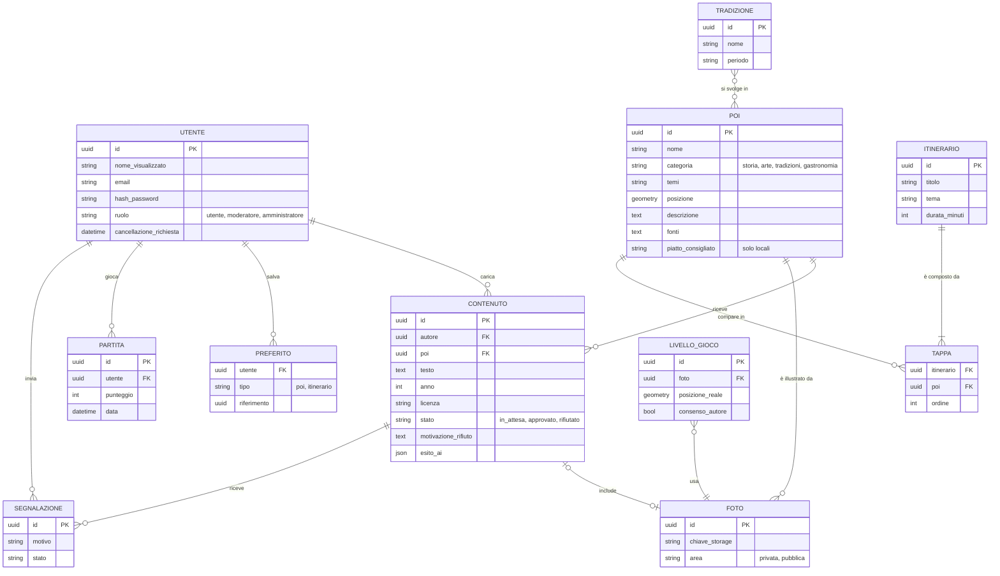

### 5.6 Storage foto

**Object storage compatibile S3** (MinIO in sviluppo, un servizio S3-compatibile in produzione).

- **Due aree.** Le foto *in attesa* stanno in un'area **privata**: il moderatore le vede con link temporanei. Solo all'approvazione vengono copiate nell'area **pubblica** (RF-16, RNF-V02).
- **Versioni ridotte.** Per ogni foto il backend genera una miniatura e una versione standard in WebP, entrambe sotto i 500 KB (RNF-P03).
- **EXIF.** I metadati personali vengono rimossi lato server anche se il frontend li ha già tolti (RNF-S05).
- Il database conserva solo il riferimento al file (`chiave_storage`), non la foto.

### 5.7 Servizi esterni

| Servizio | Uso | Note |
|---|---|---|
| **Servizio mappe** (OpenStreetMap) | Tile della mappa di base | La licenza ODbL chiede di citare "© OpenStreetMap contributors". Il server pubblico di OSM non è pensato per carichi di produzione: in produzione serve un fornitore di tile basato su OSM (§10) |
| **Servizio e-mail** (SMTP transazionale) | Conferma registrazione, reimpostazione password, esito della moderazione, conferma eliminazione account | UC-03, UC-05, UC-08 |
| **Navigatore esterno** | "Come arrivare" apre l'app di mappe del telefono con la destinazione | Sostituisce la navigazione passo-passo (RF-26, *Won't*) |

---

## 6. Decisioni architetturali

| ID | Decisione | Alternative considerate | Motivazione |
|---|---|---|---|
| **D-01** | Web app responsive installabile come PWA | App native iOS/Android | Un solo codice per tutti i dispositivi, nessuna installazione obbligatoria (RNF-PO02); le app native sono fuori ambito (Fase 2 §1.2) |
| **D-02** | Backend a monolite modulare | Microservizi | Team di 3 persone e tempi del corso: un solo progetto da avviare, testare e distribuire. I moduli separati lasciano aperta un'estrazione futura |
| **D-03** | AI Service separato dal backend | Funzioni AI dentro il backend | Linguaggio (Python) e risorse (memoria, eventuale GPU) diversi; un guasto dell'AI non blocca il resto |
| **D-04** | API Gateway come unico punto d'ingresso | Frontend collegato direttamente ai servizi | Sicurezza in un punto solo (HTTPS, token, ruoli, limiti); il frontend conosce un solo indirizzo |
| **D-05** | PostgreSQL + PostGIS | MongoDB | Query geografiche precise (vicinanza, distanze); dati fortemente collegati (utenti, contenuti, POI) che beneficiano di vincoli di integrità |
| **D-06** | Object storage per le foto | Foto salvate nel database | Database leggero, foto servite direttamente, aree pubblica e privata separate; MinIO permette di avere lo stesso sistema in locale |
| **D-07** | OpenStreetMap + Leaflet | Google Maps | Dati aperti, nessun costo per richiesta e nessuna carta di credito per la chiave; chiude il punto aperto della Fase 2 |
| **D-08** | Token JWT di breve durata + token di rinnovo | Sessioni sul server | Il gateway verifica l'identità senza interrogare il database; il backend resta senza stato e scalabile |
| **D-09** | Lavori dell'AI in una coda asincrona | Chiamate sincrone | Il caricamento di un ricordo non aspetta l'AI (RNF-U02); se l'AI è lenta o ferma i lavori restano in coda |

**Decisioni prese realizzando l'MVP**

| ID | Decisione | Alternative considerate | Motivazione |
|---|---|---|---|
| **D-10** | In sviluppo il database è PGlite (PostgreSQL + PostGIS compilato in WebAssembly, dentro Node); con `DATABASE_URL` si usa un server PostgreSQL vero | Installare PostgreSQL su ogni computer; solo Docker | Ognuno avvia il progetto con `npm install` e `npm run dev`, senza installare un database. Stesso SQL e stessa PostGIS: i test girano su entrambi |
| **D-11** | Nell'MVP il gateway è un livello del server Express (sicurezza, token, ruoli, limiti, registro) davanti ai moduli, nello stesso processo | Gateway in un processo separato | Un processo in meno da avviare e distribuire per un team di tre; i compiti restano quelli di §5.2 e il gateway si può separare in seguito senza cambiare l'API |
| **D-12** | Archivio delle foto su una cartella del server, con le due aree privata e pubblica | MinIO / S3 già nell'MVP | Stesse regole di §5.6 con un servizio in meno; il modulo `archivio-foto` ha quattro funzioni (salva, leggi, sposta, elimina) da riscrivere per passare a S3 |
| **D-13** | Backend in JavaScript (moduli ES), come il frontend | TypeScript | Un solo linguaggio e nessun passaggio di compilazione; i dati in ingresso sono comunque validati con schemi (zod) |
| **D-14** | Il gioco consegna un token firmato con i livelli della partita; il server verifica ogni risposta e ricalcola il punteggio prima di salvarlo | Calcolo del punteggio nel browser | La posizione esatta non arriva al browser prima della risposta e la classifica non si può falsare inviando un punteggio inventato |

**Stack**

| Componente | Proposta iniziale | Adottato nell'MVP |
|---|---|---|
| Frontend Web | React + Vite, Leaflet, i18next | React + Vite, Leaflet; traduzioni con un modulo interno (`versione-corrente/frontend/src/i18n`) |
| API Gateway | Node.js + Express (proxy, JWT, rate limiting) | Livello del server Express: helmet, JWT (jose), express-rate-limit (D-11) |
| Backend | Node.js + TypeScript (Express o NestJS) | Node.js + Express in JavaScript, validazione con zod (D-13) |
| AI Service | Python + FastAPI, modelli open source (es. CLIP) | Rinviato ([Fase 4 §2.2](fase-4-pianificazione.md#22-cosa-entra)) |
| Coda dei lavori | Redis (oppure una tabella nel database) | Rinviata con l'AI Service |
| Database | PostgreSQL + PostGIS | PostgreSQL 16 + PostGIS; PGlite in sviluppo (D-10) |
| Storage foto | MinIO (sviluppo) · servizio S3-compatibile (produzione) | Cartella del server con area privata e pubblica; foto ridotte in WebP con sharp (D-12) |
| E-mail | SMTP transazionale | nodemailer con `SMTP_URL`; in sviluppo "posta di prova" consultabile dal sito |
| Avvio e distribuzione | Docker Compose · GitHub Actions per i test automatici | `npm run dev` in sviluppo; Docker Compose (`db` + `app`); test con Vitest e Supertest |

---

## 7. Scenari dinamici

I diagrammi di sequenza mostrano come i componenti collaborano nei casi d'uso più importanti.

### 7.1 Consultare un POI (UC-01)

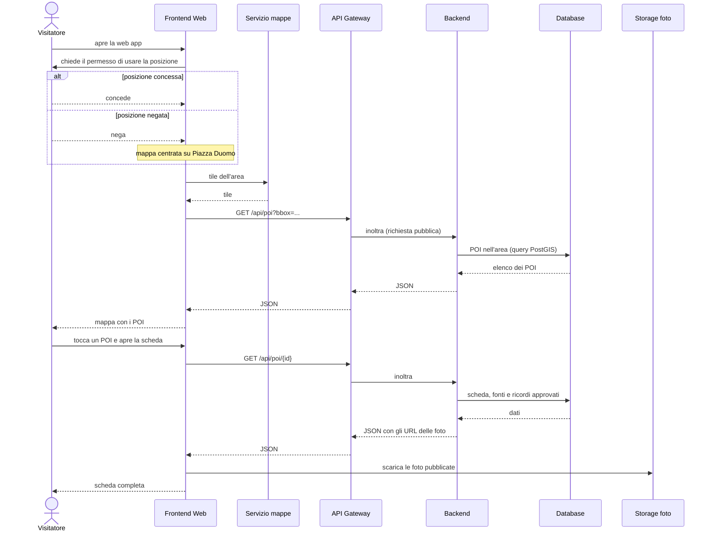

### 7.2 Caricare un ricordo (UC-04)

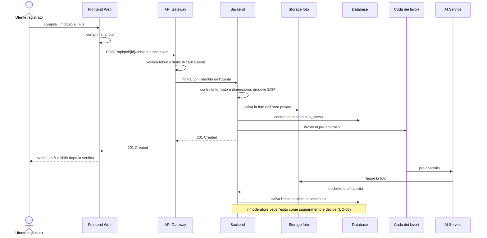

### 7.3 Riconoscere un luogo con la fotocamera (RF-06)

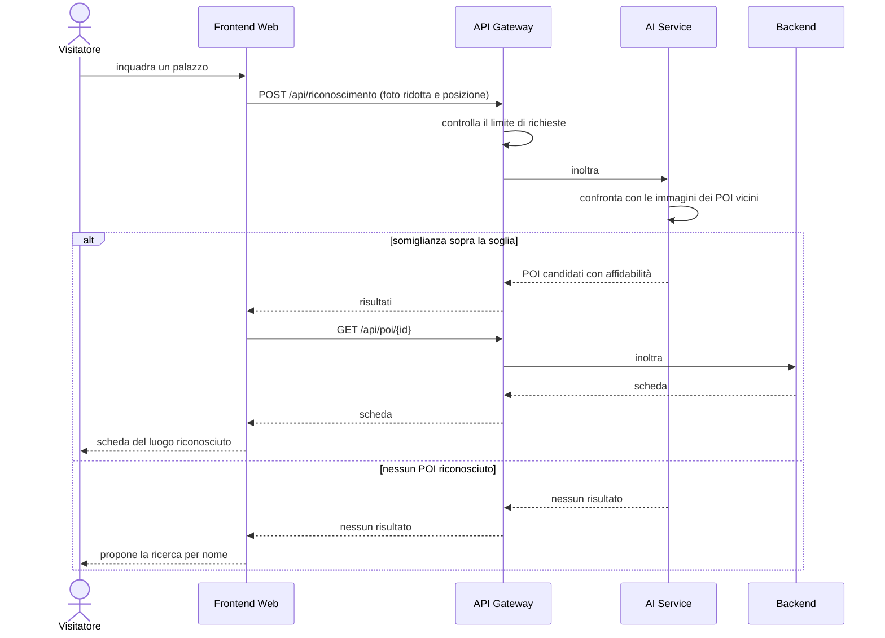

---

## 8. Vista di deployment

In sviluppo tutto il sistema si avvia con un solo comando, `docker compose up` (RNF-PO03).

| Servizio (container) | Contenuto | Esposto all'esterno |
|---|---|---|
| `frontend` | File statici della SPA serviti da Nginx | Sì, tramite il gateway |
| `gateway` | API Gateway | **Sì** (unico punto d'ingresso, HTTPS) |
| `backend` | Backend applicativo | No |
| `ai-service` | AI Service | No |
| `coda` | Redis | No |
| `db` | PostgreSQL + PostGIS | No |
| `storage` | MinIO | Solo l'area pubblica delle foto |

In produzione si mantiene la stessa divisione; il fornitore di hosting è ancora da scegliere (§10).

**Deployment dell'MVP.** Con le decisioni D-10…D-12 il `docker-compose.yml` dell'MVP ha due soli container: `db` (PostgreSQL + PostGIS, non esposto) e `app` (frontend compilato, gateway e backend in un processo Node, con un volume per le foto). In sviluppo non serve Docker: `npm run dev` avvia backend (con PGlite) e frontend. Il proxy HTTPS davanti ad `app` resta da configurare con l'hosting (RNF-S01).

---

## 9. Tracciabilità

### 9.1 Componenti ↔ requisiti

| Componente | Requisiti funzionali | Requisiti non funzionali |
|---|---|---|
| Frontend Web | Interfaccia di tutti gli RF | RNF-U01…U05, RNF-P01, RNF-P02, RNF-P03 (compressione), RNF-PO01, RNF-PO02 |
| API Gateway | — | RNF-S01, RNF-S03, RNF-S06 |
| Backend · Utenti e accessi | RF-10…RF-13, RF-25 | RNF-S02, RNF-S04 |
| Backend · POI, itinerari e tradizioni | RF-01…RF-05, RF-07…RF-09, RF-19, RF-20, RF-24 | RNF-V01, RNF-PO04 |
| Backend · Contenuti e moderazione | RF-14…RF-18 | RNF-S05 |
| Backend · Gioco | RF-21…RF-23 | — |
| AI Service | RF-06; supporto a RF-16, RF-17 | Supporto a RNF-U05 |
| Database | Persistenza di tutti gli RF | RNF-S04, RNF-PO04 |
| Storage foto | RF-14, RF-16 | RNF-P03, RNF-S05, RNF-V02 |
| Docker Compose | — | RNF-PO03, RNF-P04 (più copie del backend) |
| Servizio mappe | RF-01, RF-07, RF-20 | — |
| Servizio e-mail | RF-10, RF-11, RF-13, RF-17 | — |

### 9.2 Casi d'uso ↔ schermate

| Caso d'uso | Schermate |
|---|---|
| UC-01 Esplorare la mappa e consultare un POI | S-00, S-01, S-01L, S-02, S-03, S-04, S-12 |
| UC-02 Seguire un itinerario | S-05, S-06, S-03 |
| UC-03 Registrarsi e accedere | S-07 |
| UC-04 Caricare un ricordo | S-03, S-08 |
| UC-05 Moderare un contenuto | S-13 |
| UC-06 Giocare a "Dov'era?" | S-10 |
| UC-07 Gestire i POI | S-14 |
| UC-08 Gestire il proprio account | S-09 |
| UC-09 Gestire i ruoli | S-14 |
| UC-10 Consultare tradizioni e mappa del gusto | S-11, S-03 |

---

## 10. Punti aperti

- **Stack tecnologico:** l'MVP usa le tecnologie della colonna "Adottato" in §6 (decisioni D-10…D-14), da confermare dal team.
- **AI Service:** modelli open source ospitati da noi o API di un fornitore esterno? Nel secondo caso servono un accordo conforme al GDPR e una stima dei costi. La fattibilità di RF-06 va verificata con un prototipo su 10–20 POI.
- **Hosting di produzione:** fornitore, dominio e certificato HTTPS.
- **Tile della mappa in produzione:** scegliere un fornitore basato su OpenStreetMap con un piano adatto al carico previsto.
- **Foto rifiutate:** per quanto tempo conservarle nell'area privata prima di cancellarle.
- **Licenza predefinita dei ricordi:** da decidere (vedi [Fase 2 §6](fase-2-specifiche-requisiti.md#6-punti-aperti)).
