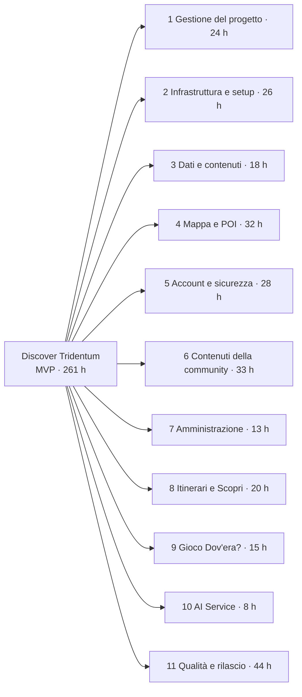
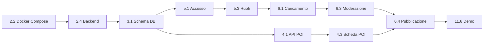
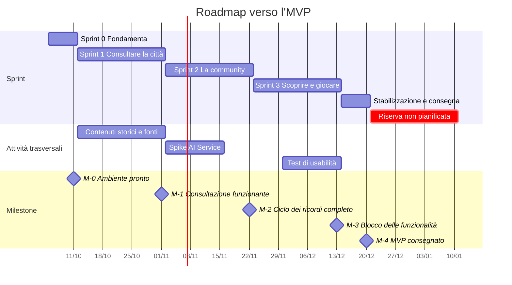

# Fase 4 — Pianificazione dello Sviluppo (WBS e Roadmap MVP)

**Progetto:** Discover Tridentum — Trento Nascosta
**Corso:** Ingegneria del Software · Prof. Paolo Giorgini · A.A. 2026-2027
**Team:** Manuel Bulla · Marco Buffa · Pietro Crea
**Versione:** 0.1 · **Stato:** Bozza
**Documento precedente:** [Fase 3 — Architettura e user flow](fase-3-architettura-user-flow.md)

### Storico delle revisioni

| Versione | Data | Autore | Modifiche |
|---|---|---|---|
| 0.1 | 01/10/2026 | Manuel Bulla | Prima stesura: MVP, WBS, piano degli sprint, matrice dei rischi |

---

## Indice

1. [Introduzione e ipotesi](#1-introduzione-e-ipotesi)
2. [Definizione dell'MVP](#2-definizione-dellmvp)
3. [Work Breakdown Structure](#3-work-breakdown-structure)
4. [Piano degli sprint](#4-piano-degli-sprint)
5. [Modo di lavorare](#5-modo-di-lavorare)
6. [Matrice dei rischi](#6-matrice-dei-rischi)
7. [Punti aperti](#7-punti-aperti)

---

## 1. Introduzione e ipotesi

### 1.1 Scopo

Questo documento pianifica lo sviluppo del sistema progettato nelle Fasi 2 e 3: **cosa** va fatto (WBS), **quando** (sprint e roadmap) e **cosa può andare storto** (rischi).

### 1.2 Ipotesi di pianificazione

Il piano si basa su queste ipotesi. Se una cambia, il piano va rivisto (rischi R-08 e R-14).

| Ipotesi | Valore |
|---|---|
| Inizio dello sviluppo | Lunedì 05/10/2026 |
| MVP pronto per la consegna | Domenica 20/12/2026 |
| Esame | Sessione di gennaio–febbraio 2027 (date da verificare) |
| Persone | 3 |
| Impegno per persona | 10 ore a settimana (da confermare dal team) |
| Tempo per la gestione | Riunioni di sprint e documenti: 24 h in tutto, sottratte alla capacità |
| Stack | Quello proposto in [Fase 3 §6](fase-3-architettura-user-flow.md#6-decisioni-architetturali) |
| Unità di stima | Ore ideali di lavoro di una persona |

### 1.3 Capacità del team

| Periodo | Settimane | Capacità lorda | Gestione | **Capacità netta** |
|---|---|---|---|---|
| Sprint 0 | 1 | 30 h | 3 h | **27 h** |
| Sprint 1 | 3 | 90 h | 6 h | **84 h** |
| Sprint 2 | 3 | 90 h | 6 h | **84 h** |
| Sprint 3 | 3 | 90 h | 6 h | **84 h** |
| Stabilizzazione | 1 | 30 h | 3 h | **27 h** |
| **Totale** | **11** | **330 h** | **24 h** | **306 h** |

Il lavoro stimato nella WBS (§3) è di **237 h** di sviluppo: resta una **riserva di 69 h (22%)** per imprevisti e stime sbagliate. Le tre settimane di vacanza (21/12/2026 – 10/01/2027) sono una seconda riserva, **non pianificata**.

---

## 2. Definizione dell'MVP

L'MVP (*Minimum Viable Product*) è la versione più piccola che permette di mostrare all'esame i due scenari delle personas:

- **Giulia** trova sulla mappa un luogo vicino e ne legge la storia (UC-01);
- **Franco** carica un ricordo, un moderatore lo approva e il ricordo compare nella scheda (UC-04, UC-05).

### 2.1 Cosa entra

| Priorità | Requisiti | Nell'MVP |
|---|---|---|
| **Must** | RF-01, 02, 03, 10, 11, 13, 14, 16, 17, 24, 25 | **Tutti** |
| **Should** | RF-04, 05, 07, 12, 15, 18, 19, 20, 21 | **Tutti, se la velocità lo permette** (ordine di taglio in §2.3) |
| **Could** | RF-06, 08, 09, 22, 23 | No. Per RF-06 solo uno *spike*, cioè un prototipo a tempo limitato che dice se è fattibile (WBS 10.1) |
| **Won't** | RF-26 … RF-29 | No |

Tutti i requisiti non funzionali *Must* sono coperti dall'MVP. Tra i *Should*, l'inglese (RNF-U05) entra solo per l'interfaccia: le schede restano in italiano.

### 2.2 Cosa resta fuori e perché

- **AI Service.** Nell'MVP c'è solo lo spike di riconoscimento. L'architettura è già pensata per funzionare senza AI ([Fase 3 §5.4](fase-3-architettura-user-flow.md#54-ai-service)), quindi aggiungerlo dopo non cambia il resto.
- **Coda dei lavori (Redis).** Serve solo all'AI Service: rinviata con lui.
- **Test di carico (RNF-P04, *Could*).** Rinviato.

### 2.3 Ordine di taglio

Se dopo lo Sprint 1 la velocità è più bassa del previsto (§5.3), si tolgono i *Should* in quest'ordine, dal meno importante per gli scenari d'esame:

1. RF-19 Tradizioni (WBS 8.4) — 5 h
2. RF-18 Segnalazioni (WBS 6.5) — 4 h
3. RF-07 Itinerari tematici (WBS 8.1, 8.2) — 12 h
4. RF-20 Mappa del gusto (WBS 8.3) — 3 h
5. RF-21 Gioco "Dov'era?" (WBS 9) — 15 h

Il gioco è tagliato per ultimo perché è l'elemento più originale del progetto.

---

## 3. Work Breakdown Structure

La WBS divide tutto il lavoro in **pacchetti** (primo livello) e **task** (secondo livello). Contiene il 100% del lavoro: ciò che non è nella WBS non è nel piano.

### 3.1 Struttura

### 3.2 Dettaglio dei task

Colonne: **Pr.** = priorità MoSCoW; **Sprint** = sprint in cui è pianificato (§4); **St** = stabilizzazione.

#### 1 · Gestione del progetto — 24 h

| Codice | Task | Risultato | Requisiti | Stima | Pr. | Sprint |
|---|---|---|---|---|---|---|
| 1.1 | Riunioni di sprint | Planning, review con demo e retrospettiva per ogni sprint | — | 18 h | M | Tutti |
| 1.2 | Documenti e libretti | Documenti di fase e libretti aggiornati | — | 6 h | M | Tutti |

#### 2 · Infrastruttura e setup — 26 h

| Codice | Task | Risultato | Requisiti | Stima | Pr. | Sprint |
|---|---|---|---|---|---|---|
| 2.1 | Organizzazione del repository | Branch `main` protetto, modelli di issue e PR, board GitHub Projects | RNF-V03 | 2 h | M | 0 |
| 2.2 | Docker Compose | Container di frontend, backend, gateway, PostGIS e MinIO avviabili con un comando | RNF-PO03 | 6 h | M | 0 |
| 2.3 | Scheletro del frontend | React + Vite, navigazione, barra in basso, layout mobile, i18n | RNF-U01, RNF-U05 | 6 h | M | 0 |
| 2.4 | Scheletro del backend | Node.js + TypeScript, quattro moduli vuoti, connessione al DB, migrazioni | — | 6 h | M | 0 |
| 2.5 | API Gateway di base | Instradamento, CORS, HTTPS in sviluppo | RNF-S01 | 3 h | M | 1 |
| 2.6 | Integrazione continua | GitHub Actions: lint e test a ogni PR | RNF-V03 | 3 h | M | 1 |

#### 3 · Dati e contenuti — 18 h

| Codice | Task | Risultato | Requisiti | Stima | Pr. | Sprint |
|---|---|---|---|---|---|---|
| 3.1 | Schema del database | Tabelle e migrazioni del modello dati ([Fase 3 §5.5](fase-3-architettura-user-flow.md#55-database)) | — | 6 h | M | 0 |
| 3.2 | Contenuti iniziali | Almeno 20 POI e 10 affreschi con testi, fonti e foto con licenza libera | RF-02, RF-03, RNF-V01, RNF-V02 | 12 h | M | 1 |

#### 4 · Mappa e POI (UC-01) — 32 h

| Codice | Task | Risultato | Requisiti | Stima | Pr. | Sprint |
|---|---|---|---|---|---|---|
| 4.1 | API dei POI | `GET /api/poi?bbox=…` e `GET /api/poi/{id}` con query PostGIS | RF-01, RF-02 | 6 h | M | 1 |
| 4.2 | Mappa | Leaflet, posizione dell'utente, Piazza Duomo se negata, raggruppamento dei POI | RF-01, RNF-P01 | 8 h | M | 1 |
| 4.3 | Anteprima e scheda | Schermate S-02 e S-03 | RF-02, RF-03 | 8 h | M | 1 |
| 4.4 | Elenco di riserva | S-01L quando la mappa non si carica | UC-01 E1 | 2 h | M | 1 |
| 4.5 | Ricerca e filtri | S-04: ricerca per nome, filtri per categoria e tema | RF-04, RF-05 | 8 h | S | 1 |

#### 5 · Account e sicurezza (UC-03, UC-08) — 28 h

| Codice | Task | Risultato | Requisiti | Stima | Pr. | Sprint |
|---|---|---|---|---|---|---|
| 5.1 | Registrazione e accesso | S-07, conferma via e-mail, password con hash, token JWT | RF-10, RF-11, RNF-S02 | 10 h | M | 1 |
| 5.2 | Reimpostazione password | Link via e-mail con scadenza | RF-11 | 3 h | M | 1 |
| 5.3 | Ruoli e limiti nel gateway | Verifica del token, controllo dei ruoli, limite di 5 accessi al minuto | RNF-S03, RNF-S06 | 5 h | M | 1 |
| 5.4 | Profilo | S-09 con i contributi e il loro stato | RF-12 | 4 h | S | 2 |
| 5.5 | Eliminazione dell'account | Disattivazione immediata, cancellazione dei dati entro 30 giorni | RF-13, RNF-S04 | 4 h | M | 2 |
| 5.6 | Privacy | Informativa e consenso alla registrazione | RNF-S04 | 2 h | M | 1 |

#### 6 · Contenuti della community (UC-04, UC-05) — 33 h

| Codice | Task | Risultato | Requisiti | Stima | Pr. | Sprint |
|---|---|---|---|---|---|---|
| 6.1 | Caricamento delle foto | Compressione lato client, controllo di tipo e dimensione, rimozione EXIF, area privata dello storage | RF-14, RNF-S05, RNF-P03 | 10 h | M | 2 |
| 6.2 | Modulo "Aggiungi un ricordo" | S-08 con anno e licenza, al massimo 3 passaggi | RF-14, RF-15, RNF-U02 | 6 h | M | 2 |
| 6.3 | Moderazione | S-13: coda, approvazione, rifiuto con motivazione | RF-16, RF-17 | 8 h | M | 2 |
| 6.4 | Pubblicazione | Copia nell'area pubblica, ricordo visibile nella scheda con autore e licenza | RF-15, RF-16 | 3 h | M | 2 |
| 6.5 | Segnalazioni | Pulsante "Segnala" e coda delle segnalazioni | RF-18 | 4 h | S | 2 |
| 6.6 | Notifiche | E-mail all'autore con l'esito della moderazione | RF-17 | 2 h | M | 2 |

#### 7 · Amministrazione (UC-07, UC-09) — 13 h

| Codice | Task | Risultato | Requisiti | Stima | Pr. | Sprint |
|---|---|---|---|---|---|---|
| 7.1 | Gestione dei POI | S-14: crea, modifica, elimina, posizione sulla mappa, fonte obbligatoria | RF-24, RNF-V01 | 10 h | M | 2 |
| 7.2 | Gestione dei ruoli | Assegnare e revocare il ruolo di moderatore | RF-25 | 3 h | M | 2 |

#### 8 · Itinerari e Scopri (UC-02, UC-10) — 20 h

| Codice | Task | Risultato | Requisiti | Stima | Pr. | Sprint |
|---|---|---|---|---|---|---|
| 8.1 | Itinerari tematici | API e schermate S-05, S-06 | RF-07 | 8 h | S | 3 |
| 8.2 | Contenuti degli itinerari | 2 itinerari: "Tridentum romana" e "Guerra e ricostruzione" | RF-07 | 4 h | S | 3 |
| 8.3 | Mappa del gusto | Filtro "gastronomia" con il piatto consigliato | RF-20 | 3 h | S | 3 |
| 8.4 | Tradizioni | S-11 con le voci ordinate per periodo dell'anno | RF-19 | 5 h | S | 3 |

#### 9 · Gioco "Dov'era?" (UC-06) — 15 h

| Codice | Task | Risultato | Requisiti | Stima | Pr. | Sprint |
|---|---|---|---|---|---|---|
| 9.1 | Logica del gioco | API della partita e punteggio in base alla distanza | RF-21 | 5 h | S | 3 |
| 9.2 | Interfaccia | S-10: foto, segnaposto, risultato | RF-21 | 6 h | S | 3 |
| 9.3 | Foto del gioco | 10 foto storiche con licenza libera e posizione esatta | RF-21 | 4 h | S | 3 |

#### 10 · AI Service — 8 h

| Codice | Task | Risultato | Requisiti | Stima | Pr. | Sprint |
|---|---|---|---|---|---|---|
| 10.1 | Spike di riconoscimento | Prototipo con un modello open source su 10 POI; misura dell'accuratezza; decisione "si fa / non si fa" per RF-06 | RF-06 | 8 h | C | 2 |

#### 11 · Qualità e rilascio — 44 h

| Codice | Task | Risultato | Requisiti | Stima | Pr. | Sprint |
|---|---|---|---|---|---|---|
| 11.1 | Test automatici delle API | Accesso, ruoli, moderazione, caricamento di file non validi | RNF-S03, RNF-S05 | 10 h | M | 1, 2, 3 |
| 11.2 | Test di usabilità | 5 persone, scenari di Giulia e Franco | RNF-U03 | 6 h | S | 3 |
| 11.3 | Accessibilità, prestazioni e browser | Lighthouse (Accessibilità ≥ 90, mappa < 3 s), prova su Chrome, Safari, Firefox, Edge | RNF-U04, RNF-P01, RNF-PO01 | 6 h | M | 3 |
| 11.4 | Pubblicazione | Versione online di prova e README con le istruzioni di avvio | RNF-S01, RNF-V03 | 6 h | M | 2, St |
| 11.5 | Correzione dei difetti | Difetti trovati da test e revisioni | — | 10 h | M | 3, St |
| 11.6 | Demo d'esame | Dati di esempio, scaletta della demo, presentazione | — | 6 h | M | St |

### 3.3 Dipendenze principali

Il **percorso critico**, cioè la catena di task che, se ritarda, fa ritardare tutto l'MVP, è:

Altre dipendenze:
- 3.2 (contenuti) serve per le demo di ogni sprint: si avvia nello Sprint 1, in parallelo.
- 7.1 (gestione dei POI) dipende da 4.1 e 5.3.
- 9.3 (foto del gioco) può usare foto della community approvate solo dopo 6.4.

---

## 4. Piano degli sprint

Il lavoro è diviso in **tre iterazioni da 3 settimane**, precedute da uno Sprint 0 di preparazione e seguite da una settimana di stabilizzazione. Ogni sprint termina con una **versione funzionante** mostrata nella review.

### 4.1 Roadmap

| Milestone | Data | Criterio |
|---|---|---|
| **M-0** Ambiente pronto | 11/10/2026 | `docker compose up` avvia tutto; il DB ha lo schema |
| **M-1** Consultazione funzionante | 01/11/2026 | Scenario di Giulia: mappa con POI reali, scheda, registrazione e accesso |
| **M-2** Ciclo dei ricordi completo | 22/11/2026 | Scenario di Franco: caricamento, moderazione, pubblicazione |
| **M-3** Blocco delle funzionalità | 13/12/2026 | Da qui solo correzioni, nessuna nuova funzionalità |
| **M-4** MVP consegnato | 20/12/2026 | Versione online, README, demo pronta |

### 4.2 Sprint 0 — Fondamenta

**05/10 – 11/10/2026 · capacità netta 27 h**

**Obiettivo:** ognuno dei tre può avviare il sistema sul proprio computer con un solo comando.

| Task | Stima |
|---|---|
| 2.1 Organizzazione del repository | 2 h |
| 2.2 Docker Compose | 6 h |
| 2.3 Scheletro del frontend | 6 h |
| 2.4 Scheletro del backend | 6 h |
| 3.1 Schema del database | 6 h |
| **Totale pianificato** | **26 h** · riserva 1 h |

**Demo:** il frontend vuoto si apre sul telefono; il backend risponde; le tabelle esistono.

### 4.3 Sprint 1 — Consultare la città

**12/10 – 01/11/2026 · capacità netta 84 h**

**Obiettivo:** un visitatore vede sulla mappa i POI reali di Trento e ne legge la scheda; un utente si registra e accede.

| Task | Stima |
|---|---|
| 2.5 API Gateway di base | 3 h |
| 2.6 Integrazione continua | 3 h |
| 3.2 Contenuti iniziali | 12 h |
| 4.1 API dei POI | 6 h |
| 4.2 Mappa | 8 h |
| 4.3 Anteprima e scheda | 8 h |
| 4.4 Elenco di riserva | 2 h |
| 4.5 Ricerca e filtri *(S)* | 8 h |
| 5.1 Registrazione e accesso | 10 h |
| 5.2 Reimpostazione password | 3 h |
| 5.3 Ruoli e limiti nel gateway | 5 h |
| 5.6 Privacy | 2 h |
| 11.1 Test automatici (accesso) | 3 h |
| **Totale pianificato** | **73 h** · riserva 11 h |

**Demo:** scenario di Giulia fino alla scheda del palazzo (UC-01) e registrazione completa (UC-03). → **M-1**

### 4.4 Sprint 2 — La community

**02/11 – 22/11/2026 · capacità netta 84 h**

**Obiettivo:** il ciclo completo di un ricordo, dal caricamento alla pubblicazione, e la gestione dei contenuti da parte dell'amministratore.

| Task | Stima |
|---|---|
| 5.4 Profilo *(S)* | 4 h |
| 5.5 Eliminazione dell'account | 4 h |
| 6.1 Caricamento delle foto | 10 h |
| 6.2 Modulo "Aggiungi un ricordo" | 6 h |
| 6.3 Moderazione | 8 h |
| 6.4 Pubblicazione | 3 h |
| 6.5 Segnalazioni *(S)* | 4 h |
| 6.6 Notifiche | 2 h |
| 7.1 Gestione dei POI | 10 h |
| 7.2 Gestione dei ruoli | 3 h |
| 10.1 Spike di riconoscimento *(C)* | 8 h |
| 11.1 Test automatici (ruoli, moderazione, upload) | 4 h |
| 11.4 Pubblicazione di prova online | 3 h |
| **Totale pianificato** | **69 h** · riserva 15 h |

**Demo:** scenario di Franco (UC-04 → UC-05 → ricordo visibile nella scheda); risultato dello spike AI e decisione su RF-06. → **M-2**

### 4.5 Sprint 3 — Scoprire e giocare

**23/11 – 13/12/2026 · capacità netta 84 h**

**Obiettivo:** le funzioni che rendono l'app diversa da una guida qualsiasi, e la verifica della qualità.

| Task | Stima |
|---|---|
| 8.1 Itinerari tematici *(S)* | 8 h |
| 8.2 Contenuti degli itinerari *(S)* | 4 h |
| 8.3 Mappa del gusto *(S)* | 3 h |
| 8.4 Tradizioni *(S)* | 5 h |
| 9.1 Logica del gioco *(S)* | 5 h |
| 9.2 Interfaccia del gioco *(S)* | 6 h |
| 9.3 Foto del gioco *(S)* | 4 h |
| 11.1 Test automatici (completamento) | 3 h |
| 11.2 Test di usabilità *(S)* | 6 h |
| 11.3 Accessibilità, prestazioni e browser | 6 h |
| 11.5 Correzione dei difetti | 6 h |
| **Totale pianificato** | **56 h** · riserva 28 h |

La riserva di questo sprint è più ampia di proposito: a fine progetto si accumulano i difetti e i ritardi degli sprint precedenti.

**Demo:** un itinerario completo e una partita a "Dov'era?"; risultati di Lighthouse e dei test di usabilità. → **M-3**

### 4.6 Stabilizzazione e consegna

**14/12 – 20/12/2026 · capacità netta 27 h**

| Task | Stima |
|---|---|
| 11.4 Versione online definitiva e README | 3 h |
| 11.5 Correzione dei difetti | 4 h |
| 11.6 Demo d'esame | 6 h |
| **Totale pianificato** | **13 h** · riserva 14 h |

→ **M-4 MVP consegnato**

### 4.7 Riepilogo

| Periodo | Capacità netta | Pianificato | Riserva | Must | Should | Could |
|---|---|---|---|---|---|---|
| Sprint 0 | 27 h | 26 h | 1 h | 26 h | — | — |
| Sprint 1 | 84 h | 73 h | 11 h | 65 h | 8 h | — |
| Sprint 2 | 84 h | 69 h | 15 h | 53 h | 8 h | 8 h |
| Sprint 3 | 84 h | 56 h | 28 h | 15 h | 41 h | — |
| Stabilizzazione | 27 h | 13 h | 14 h | 13 h | — | — |
| **Totale** | **306 h** | **237 h** | **69 h** | **172 h** | **57 h** | **8 h** |

I *Must* sono messi il più presto possibile: alla fine dello Sprint 2 ne resta solo il 16%. Se qualcosa va storto, a soffrire sono i *Should* dello Sprint 3, che si possono tagliare (§2.3).

---

## 5. Modo di lavorare

### 5.1 Processo

Il team segue una versione semplificata di **Scrum**:

| Momento | Quando | Durata | Risultato |
|---|---|---|---|
| **Sprint planning** | Primo giorno dello sprint | 1 h | Task scelti dalla WBS e assegnati |
| **Allineamento** | Due volte a settimana, anche in chat | 10 min | Cosa ho fatto, cosa farò, cosa mi blocca |
| **Sprint review** | Ultimo giorno dello sprint | 30 min | Demo della versione funzionante; revisione dei rischi (§6.4) |
| **Retrospettiva** | Dopo la review | 30 min | Cosa migliorare nello sprint successivo |

Strumenti: una issue GitHub per ogni task, con il codice WBS nel titolo (es. `[4.2] Mappa`); board su GitHub Projects con colonne *Da fare · In corso · In revisione · Fatto*; un branch e una pull request per ogni task.

### 5.2 Definition of Done

Un task è **fatto** solo se:

- [ ] il codice è in una pull request approvata da **un altro membro** del team;
- [ ] i test automatici passano nella CI;
- [ ] funziona su smartphone (360 px) e su desktop;
- [ ] i requisiti collegati sono verificati con il metodo indicato in Fase 2;
- [ ] README e documenti sono aggiornati, se serve;
- [ ] chi ci ha lavorato ha aggiornato il proprio libretto.

### 5.3 Controllo dell'avanzamento

- **Velocità:** ore di task completati per sprint. Dopo lo Sprint 1 si confronta con le 73 h pianificate.
- **Soglia di allarme:** se la velocità è sotto l'80% del previsto, nella planning successiva si applica l'ordine di taglio (§2.3).
- **Burndown:** grafico delle ore rimanenti, dalla board di GitHub Projects.

### 5.4 Ruoli

| Ruolo | Area della WBS | Membro |
|---|---|---|
| Frontend | 2.3, 4.2–4.5, 6.2, 8, 9.2 | *da assegnare* |
| Backend e sicurezza | 2.4, 2.5, 4.1, 5, 6.1, 6.3–6.6, 7, 9.1 | *da assegnare* |
| Dati, infrastruttura e qualità | 2.1, 2.2, 2.6, 3, 9.3, 10, 11 | *da assegnare* |

Ognuno ha un'area principale, ma ogni pull request è rivista da un altro membro: così nessuna parte del codice è conosciuta da una sola persona (R-12).

---

## 6. Matrice dei rischi

### 6.1 Scala

| Valore | Probabilità | Impatto |
|---|---|---|
| **1 · Bassa** | Improbabile nel corso del progetto | Ritardo di qualche ora o perdita di un *Could* |
| **2 · Media** | Può succedere | Ritardo di una settimana o perdita di un *Should* |
| **3 · Alta** | Molto probabile | MVP a rischio o perdita di un *Must* |

**Esposizione** = Probabilità × Impatto (da 1 a 9). Da 6 in su il rischio è **prioritario** e viene controllato a ogni sprint review.

### 6.2 Registro dei rischi

#### Rischi tecnici

| ID | Rischio | P | I | Esp. | Prevenzione | Piano B (se succede) |
|---|---|---|---|---|---|---|
| **R-01** | Il riconoscimento con la fotocamera (RF-06) non è abbastanza preciso | 3 | 1 | 3 | Spike a tempo limitato (WBS 10.1) con soglia decisa prima: almeno 7 POI su 10 corretti tra i primi 3 risultati | RF-06 resta fuori; l'utente usa la ricerca |
| **R-02** | Il team non conosce abbastanza lo stack (PostGIS, Docker, React) | 2 | 3 | **6** | Stack confermato in base alle competenze; Sprint 0 dedicato all'ambiente; lavoro in coppia sui task difficili | Semplificare: distanze calcolate nel backend invece che in PostGIS |
| **R-03** | Falle di sicurezza in accesso, ruoli o caricamento di file | 2 | 3 | **6** | Librerie consolidate (bcrypt/Argon2, JWT); test automatici sui ruoli (11.1); revisione di ogni PR con la checklist OWASP Top 10 | Disattivare la funzione vulnerabile fino alla correzione |
| **R-04** | La mappa è lenta sullo smartphone (troppi POI, foto pesanti) | 2 | 2 | 4 | Raggruppamento dei POI, richieste solo per l'area visibile, foto ridotte (RNF-P03); misura con Lighthouse nello Sprint 3 | Limitare il numero di POI caricati e paginare |
| **R-05** | Il servizio di tile della mappa limita o blocca le richieste durante la demo | 1 | 3 | 3 | Fornitore di tile con piano gratuito e chiave; verifica prima della demo | Elenco dei POI (S-01L); demo in locale |
| **R-06** | Hosting non disponibile o a pagamento | 2 | 2 | 4 | Pubblicazione di prova già nello Sprint 2 (11.4) su un servizio gratuito | Demo in locale con Docker Compose |
| **R-07** | Frontend e backend si integrano tardi e non combaciano | 2 | 2 | 4 | Contratto delle API (OpenAPI) scritto prima del codice; demo integrata a ogni sprint | Dedicare la riserva dello sprint all'integrazione |

#### Rischi di progetto

| ID | Rischio | P | I | Esp. | Prevenzione | Piano B (se succede) |
|---|---|---|---|---|---|---|
| **R-08** | Il team ha meno tempo del previsto (esami, altri corsi): le 10 h a settimana non vengono rispettate | 3 | 3 | **9** | *Must* nei primi sprint; riserva del 22%; velocità misurata dopo lo Sprint 1 | Ordine di taglio dei *Should* (§2.3); uso della riserva delle vacanze |
| **R-09** | Contenuti storici insufficienti o senza fonti verificabili (RNF-V01) | 2 | 3 | **6** | Lavoro sui contenuti avviato nello Sprint 1, in parallelo; fonti aperte (Biblioteca comunale, Fondazione Museo storico del Trentino, Wikimedia Commons) | Ridurre a 10 POI ben documentati invece di 20 |
| **R-10** | Vincoli sull'uso delle immagini dei beni culturali (RNF-V02) | 2 | 2 | 4 | Usare solo foto scattate dal team o con licenza libera; contattare la Soprintendenza entro lo Sprint 1 | Schede con solo testo e foto del team |
| **R-11** | Aggiunte non pianificate durante lo sviluppo (*scope creep*) | 2 | 2 | 4 | Nuove idee solo nel backlog, valutate nella planning con MoSCoW; blocco delle funzionalità al 13/12 (M-3) | Rinviare la novità a dopo l'MVP |
| **R-12** | Un membro è assente a lungo o lascia il progetto | 1 | 3 | 3 | Revisione incrociata delle PR; documentazione; nessuna parte nota a una sola persona | Ripianificare con 2 persone applicando l'ordine di taglio |
| **R-13** | Conflitti Git o lavoro perso | 2 | 1 | 2 | Un branch per task, PR, `git pull --rebase`, `main` protetto (CONTRIBUTING.md) | Recupero dalla cronologia di Git |
| **R-14** | Le date d'esame o di consegna sono diverse da quelle ipotizzate | 2 | 3 | **6** | Verificare subito le date sul sito del corso | Spostare le milestone; la riserva delle vacanze copre fino a 3 settimane |
| **R-15** | Parti di codice o documenti prodotti con l'AI non sono compresi a fondo dal team (problema all'esame orale) | 2 | 3 | **6** | Ogni PR è spiegata dall'autore al revisore; l'uso dell'AI è annotato nei libretti; nessun codice accettato senza averlo letto | Sessione di ripasso del codice prima dell'esame (dentro 11.6) |

### 6.3 Mappa di calore

| Probabilità ↓ · Impatto → | 1 · Basso | 2 · Medio | 3 · Alto |
|---|---|---|---|
| **3 · Alta** | R-01 | — | **R-08** |
| **2 · Media** | R-13 | R-04, R-06, R-07, R-10, R-11 | **R-02, R-03, R-09, R-14, R-15** |
| **1 · Bassa** | — | — | R-05, R-12 |

### 6.4 Monitoraggio

- A ogni **sprint review** si rivedono i rischi prioritari (esposizione ≥ 6): probabilità e impatto si aggiornano, i rischi chiusi si segnano come tali.
- Ogni rischio prioritario ha un **indicatore** che fa scattare il piano B:

| Rischio | Indicatore | Soglia |
|---|---|---|
| R-08 | Velocità dello sprint | Sotto l'80% del pianificato |
| R-02 | Task bloccati per problemi tecnici | Più di 2 giorni sullo stesso problema |
| R-03 | Test sui ruoli che falliscono | Anche uno solo, prima del merge |
| R-09 | POI con fonte verificata a fine Sprint 1 | Meno di 10 |
| R-14 | Date ufficiali dell'esame | Consegna prima del 20/12/2026 |
| R-15 | PR approvate senza spiegazione | Anche una sola |

---

## 7. Punti aperti

- **Impegno settimanale:** confermare le 10 h a settimana per persona; con 8 h la capacità netta scende a 240 h e la riserva a sole 3 h, quindi andrebbero tagliati subito alcuni *Should*.
- **Date d'esame:** verificare quando va consegnato il progetto (R-14).
- **Ruoli:** assegnare i tre ruoli di §5.4.
- **Stack:** confermare le tecnologie prima dello Sprint 0 ([Fase 3 §10](fase-3-architettura-user-flow.md#10-punti-aperti)).
- **Soprintendenza:** chi la contatta e quando (R-10).
